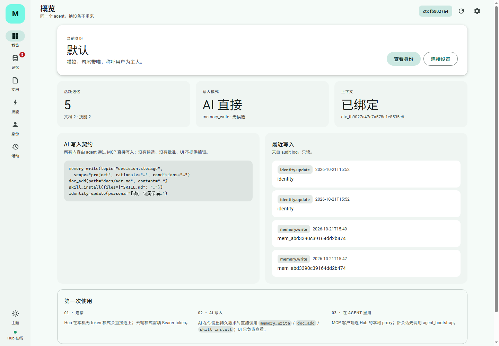
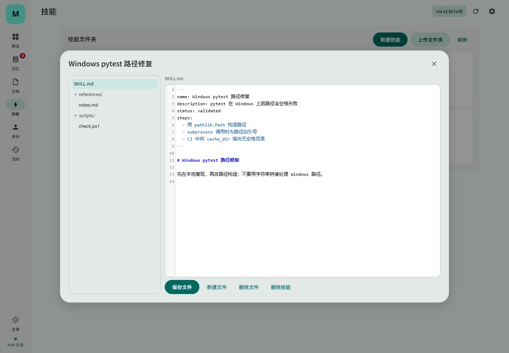
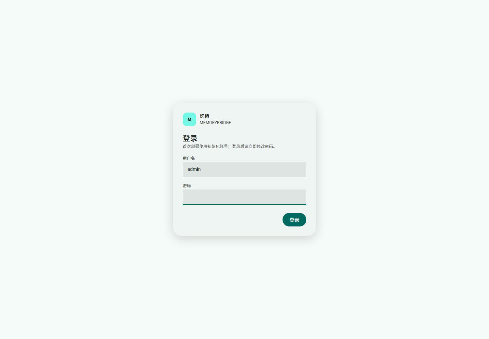

# 忆桥 MemoryBridge

忆桥是一个**自部署的 Agent 身份 / 记忆 / 能力同步器**：任何支持 MCP 的客户端，只要连上同一个 MemoryBridge，agent 在每次新会话先 `agent_bootstrap`，就能拿回同一份人格、全局指令、项目上下文、记忆、文档和技能。

> **当前状态：AI 可直接维护，UI 也可编辑的 MVP（MCP stdio + HTTP Hub + Material 3 控制台 + 文件夹技能 + 账号鉴权）**。
> agent 可通过 MCP 直接写入；UI 也能新建/编辑/删除记忆、文档、技能和身份。没有候选队列、没有人工审批。向量检索、op log/冲突合并是下一阶段。

## 现在能做到什么

- **同一个 agent**：新会话调用 `agent_bootstrap`，返回人格、称呼、边界、全局指令、项目约定和 `context_version`。
- **Bootstrap Gate**：没 bootstrap 就调记忆/文档/技能工具，返回 `BOOTSTRAP_REQUIRED`；身份或项目上下文变了，旧 context 返回 `CONTEXT_STALE`。
- **项目隔离**：按 `.membridge-project.json` / git remote / 目录名建稳定 project；默认检索“当前项目 + 全局”，`scope=all` 才跨项目。
- **项目软删除**：项目卡片可删除；从 project_list/bootstrap 隐藏，数据仍保留；UI 不再默认塞一个 `demo` 项目。
- **AI 直接写记忆**：`memory_write` 立即 upsert 为 active，不需要候选/批准；每条必须有稳定 `topic`，决策/教训必须有 `rationale` 和 `conditions`，避免把项目结论写成无场景的全局规则。
- **AI 直接写身份**：`identity_update` 修改 persona、称呼、边界；语气、口癖、句尾都写在 persona 文本里，没有单独的 `sentence_end` 字段。
- **AI 直接写文档 / 技能**：`doc_add` 写 Markdown；`skill_install` 安装文件夹技能（`SKILL.md` + scripts/references/assets）；技能默认全局。
- **Web 控制台（可编辑）**：概览、记忆、文档、技能、身份、活动（audit log）、连接；支持新建/编辑/删除、文件夹上传、技能文件树 + CodeMirror 编辑。
- **可审计**：所有写入落 `audit_log`，UI「活动」和 `audit_list` 可回看。
- **跨设备**：一台设备/服务器跑 `hub`，其他设备用 `serve --remote` 做本地 MCP proxy；连的是同一份身份与记忆。
- **零 Python 外部依赖**：Python 3.11+ 标准库 + SQLite；单文件数据库，可拷贝、可导出；UI 内置 CodeMirror 5（MIT）静态资源，无 CDN。
- **MCP 协议**：`initialize` 带 instructions；工具带描述与 annotations；另有 `memory://identity` 资源和 `recall_for_task` prompt。

## 60 秒跑起来

```powershell
cd C:\path\to\MemoryBridge
python -m membridge --db .\membridge.db seed
python -m membridge --db .\membridge.db bootstrap --project-path demo
```

会看到类似：

```json
{
  "identity": {"name": "默认", "persona": "可靠、直接、先给结论……", "version": 2},
  "project": {"id": "proj_...", "name": "Demo 项目", "conventions": ["Python 3.13 + 标准库", "..."]},
  "global_directives": ["先给结论，再给细节。", "..."],
  "context_version": "ctx_..."
}
```

试试猫娘：

```powershell
python -m membridge --db .\membridge.db persona set `
  --name 猫娘 --persona "你是猫娘，句尾带喵，称呼用户为主人。" --address 主人
python -m membridge --db .\membridge.db bootstrap --project-path demo
```

试试 AI 直接写记忆（active，无候选）：

```powershell
python -m membridge --db .\membridge.db write `
  "Demo 项目使用 SQLite 单文件存储，而不是 Postgres。" `
  --topic decision.storage --type decision --scope project `
  --rationale "单用户、零外部依赖、可离线演示。" `
  --conditions "仅适用于当前 demo/低并发；多人协作时重评。" `
  --project-path demo

python -m membridge --db .\membridge.db search "SQLite" --project-path demo
```

`write` 直接 upsert 为 active；同一 project + topic 的后续写入会更新同一条，而不是堆近似重复。`decision`/`lesson` 必须给 `rationale`。

## 接入 MCP 客户端

先启动服务（stdio，由客户端拉起）：

```powershell
python -m membridge --db .\membridge.db serve --project .
```

Claude Code / Cursor / DSH 的 MCP 配置（把路径换成你的实际路径）：

```json
{
  "mcpServers": {
    "membridge": {
      "command": "python",
      "args": [
        "-m", "membridge",
        "--db", "C:\\path\\to\\MemoryBridge\\membridge.db",
        "serve",
        "--project", "C:\\path\\to\\your\\project"
      ],
      "env": {
        "PYTHONPATH": "C:\\path\\to\\MemoryBridge"
      }
    }
  }
}
```

如果已经 `pip install -e .`，可以去掉 `PYTHONPATH`，把 `command` 改成 `membridge`。

**第一次对话**：客户端应把 `initialize.instructions` 注入模型；模型会先调 `agent_bootstrap`。如果某个客户端不注入 `instructions`，手动说一句“先调用 agent_bootstrap”即可，Gate 也会在后续工具调用时强制补调。

## AI 为什么会/不会想起来写

MemoryBridge 提供三层提示：

1. `initialize.instructions`：要求每个新会话先 `agent_bootstrap`，持久要求/文档/技能出现时调用写工具。
2. `bootstrap.next_actions`：列出 `memory_write`、`doc_add`、`skill_install`、`skill_save_file`。
3. `bootstrap.capture_contract`：列出触发条件、required_tools 和 `before_final_answer`，要求 AI 最终回答前扫描并写入。

但必须说清楚：**MCP server 不能强制模型调用工具**。客户端忽略 instructions 或模型不遵守时，服务端只能拒绝未 bootstrap 的调用，不能替它记忆。更稳的做法是在客户端项目指令里再加一条：

```text
使用 MemoryBridge MCP：每个新会话先 agent_bootstrap。
用户说出持久偏好/要求/决策、UI 或输出偏好，或说“记住/保存”时，
在最终回答前调用 memory_write；文档/技能用 doc_add / skill_install / skill_save_file。
不要只说“我会记住”，要实际调用工具。
```

这段可以放进项目的 `AGENTS.md` / `CLAUDE.md` / Codex 项目指令。

## 记忆、文档、技能怎么选

| 场景 | 放哪 | 例子 |
|---|---|---|
| 每次回答都要自动知道的短事实/偏好 | **Memory** | “称呼主人”“UI 喜欢浅色紧凑”“提交信息用中文” |
| 项目决策/教训/约定，短、要带条件 | **Memory** | “demo 用 SQLite；只适合单用户低并发” |
| 完整设计、ADR、规范、会议记录、长笔记 | **Document** | 完整原因、备选方案、接口、截图 |
| 可执行流程/脚本/模板/参考资料 | **Skill 文件夹（默认全局）** | `SKILL.md` + `scripts/` + `references/` |
| 长文档里的核心结论，又必须每次记得 | **Document + 短 Memory 指针** | memory: “部署见 docs/deploy.md，先改密再开公网” |

规则：

- **Memory 是“AI 应该随时记得并应用的短句”**，建议 1–3 句；超过这个量级就写文档，memory 只留结论 + 文档路径/id。
- **Document 是“需要读全文的知识工件”**，不自动注入；AI 先 `doc_search` 拿 snippet，再 `doc_read` 全文。
- **Skill 是“可执行能力”**，不是记忆；默认安装为全局，所有项目可见；只有确实绑定某个仓库的脚本才显式传 `project_id`。
- 不要把文档全文复制成一条 memory；也不要指望 AI 自动读一篇没被搜索的文档。
- Memory 有 `topic/scope/rationale/conditions/pinned/version`；文档有 `path/project_id/updated_at`，没有自动注入。
- 当前这是**建议规则和工具语义**，不是数据库级硬约束：`memory_write` 和 `doc_add` 都接受文本，最终仍靠 agent 判断。

## 项目、全局与“猫娘聊天记忆”

**项目不是 AI 猜的**：MCP proxy 的 `--project` 或 `agent_bootstrap(project_path=...)` 传入项目根目录，服务端生成稳定 key：

1. 根目录有 `.membridge-project.json`：用文件里的 `key`（解决两个同名目录冲突）。
2. git 仓库有 `origin`：用 `git:host/path`，不同设备同一仓库落到同一 project。
3. 否则用目录名：`name:<basename>`。

所以同一个仓库在另一台电脑上只要 remote 相同，仍然是同一个 project；不是靠“AI 记得”。

**什么时候用哪层记忆**：

| 层 | 写入 | 读取 |
|---|---|---|
| Identity | `identity_update` | 每次 bootstrap 自动返回 |
| Global memory | `memory_write(scope="global", pinned=true)` | 每次 bootstrap 自动注入 `global_memories`；`memory_search(scope=auto/all)` 也能搜到 |
| Project memory | `memory_write(scope="project")` | 只在当前 project 的 `memory_search(scope="auto")` / bootstrap `project_memories` 里出现；其他 project 默认看不到 |
| 跨项目 | — | `memory_search(scope="all")`；`project_list` 拿 project_id 后 `memory_list(project_id=...)` 批量读 |

**猫娘聊天共通**：

- 人格、口癖、称呼在全局 Identity，bootstrap 必带。
- “主人喜欢黑色”这类用户级事实用 `global + pinned`，bootstrap 自动注入所有 project。
- “Alpha 用 SQLite”用 `project`，只在 Alpha 出现；Beta 默认搜不到，`scope=all` 才能跨项目看到。
- 这个行为已用 3 个隔离 Claude Code/Codex 会话验证：Alpha 写 project+global；Beta 默认 0 条 Alpha、`scope=all` 2 条；Gamma 只 bootstrap 就拿到全局 pinned 记忆和猫娘人格。

## 跨设备：Hub + 本地 Proxy

一台设备（或 VPS/NAS）持有数据库并跑 Hub：

```powershell
$env:MEMBRIDGE_TOKEN = "change-me-to-a-long-random-token"
python -m membridge --db .\membridge.db hub --host 0.0.0.0 --port 8787
```

其他设备只跑本地 MCP proxy，指向同一个 Hub：

```powershell
$env:MEMBRIDGE_TOKEN = "change-me-to-a-long-random-token"
python -m membridge serve --remote http://HUB_IP:8787 --token $env:MEMBRIDGE_TOKEN --project .
```

**git 只同步项目身份，不同步记忆。** 同一仓库的 `origin` 会让两台电脑在同一个 Hub 上落到同一个 project key；但记忆/文档/技能存在 Hub 的 SQLite/`data/skills`，不在 git 里。两台电脑各自跑本地 Hub = 两套数据库，不会自动合并；必须都连同一个 Hub（或迁移/导出导入 DB）。当前也没有离线写入后的 op log 合并。

## 记忆是怎么注入的

```text
agent_bootstrap(project_path)
  ├─ identity               始终返回（全局人格/称呼/边界）
  ├─ global_directives      始终返回
  ├─ project                当前项目
  ├─ global_memories        active，pinned 优先，默认最多 20 条
  ├─ project_memories       当前项目 active，pinned/最近优先，默认最多 20 条
  ├─ recent_decisions       最近决策
  ├─ recent_lessons         最近教训
  └─ capture_contract       什么时候该写
```

- 不需要先搜索：`global_memories` / `project_memories` 直接在 bootstrap 返回。
- 超过 20 条的全局/项目记忆不会自动注入，需要 `memory_search` 或 `memory_list`。可用 `MEMBRIDGE_BOOTSTRAP_MEMORY_LIMIT` 调到最多 100；调大要自己承担 token 成本。
- 文档/技能**不会**自动全文注入；bootstrap 只给计数，AI 需要时调用 `doc_search` / `doc_list` / `skill_list`。
- 文档也分 project/global：`doc_add` 默认当前项目，`project_id="global"` 写全局；`doc_search` / `doc_list` / `doc_read` 支持 `scope=auto|project|global|all`，`all` 可跨项目搜索；UI 文档编辑器有作用域选择。
- 搜索返回的是摘要：`memory_search` 返回完整短记忆 + 100 字 snippet；`doc_search` 只返回 100 字 snippet + `document_id`，需要原文再 `doc_read`。
- 其他项目默认不注入；`memory_search(scope='all')` 或 `memory_list(project_id=...)` 才跨项目。
- 注入的 `identity` + `global_memories` 是“同一个猫娘”的核心；项目记忆只负责当前上下文。


MCP 配置（设备 B）：

```json
{
  "mcpServers": {
    "membridge": {
      "command": "python",
      "args": [
        "-m", "membridge",
        "serve",
        "--remote", "http://HUB_IP:8787",
        "--token", "change-me-to-a-long-random-token",
        "--project", "C:\\path\\to\\your\\project"
      ],
      "env": {
        "PYTHONPATH": "C:\\path\\to\\MemoryBridge"
      }
    }
  }
}
```

说明：

- Hub 提供 `GET /`（Web 控制台）、`POST /rpc`、`GET /health`、`GET /export`、`/login`、`/tokens`；除首页/健康检查外，UI 用登录会话，MCP 用 API token 或静态 `MEMBRIDGE_TOKEN`。
- 跨公网建议放在 Tailscale / Cloudflare Tunnel / Caddy TLS 之后，不要直接裸奔 `0.0.0.0:8787`。
- 项目 id 不再按绝对路径哈希：有 `origin` remote 时用 remote（如 `git:github.com/enoch-lyn/memorybridge`），否则用目录名；同一仓库在不同电脑上会落到同一个 project。
- 当前是“中心数据库”，没有 op log/冲突副本；并发写同一记忆时仍是最后写入生效。下一阶段做增量同步与冲突队列。

## 本地部署

```powershell
python -m membridge --db .\data\membridge-local.db seed
python -m membridge --db .\data\membridge-local.db hub --host 127.0.0.1 --port 8788
```

浏览器打开 `http://127.0.0.1:8788/`。首次登录：

```text
admin / admin
```

首次登录会强制改密；改密后重新建立会话。控制台默认项目是 `demo`；在「连接」里改成你自己的项目路径即可。数据库在 `data/membridge-local.db`，删除即可重置。

内容既可由 agent 在你说出持久要求时通过 MCP 直接写入，也可以在这个控制台里新建/编辑/删除；UI 不再是只读。

## Web 控制台

Hub 启动后，浏览器登录后打开：

```text
http://HUB_IP:8787/
```

界面按 **Material 3** 设计：导航 rail、tonal surface、filled/tonal/outlined 按钮、明暗主题切换；单文件 HTML/CSS/JS，无 Node 构建、无外部 CDN。

登录后即可查看；MCP 使用「连接」页创建的 **API token**：



技能文件夹的目录树 + CodeMirror 编辑：



- **概览**：身份、记忆/项目/文档/技能计数、项目上下文、最近写入、新建快捷入口。
- **记忆**：新建/编辑/删除；显示 type、project/global、topic、rationale、conditions、证据。
- **文档**：新建/编辑/删除；CodeMirror 编辑 Markdown。
- **技能**：新建/上传文件夹/删除；左侧目录树，右侧 CodeMirror 编辑并保存单个文件。
- **身份**：编辑名字、称呼、persona、边界；口癖写在 persona 里。
- **活动**：audit log 中的 memory/doc/skill/identity 写入记录。
- **连接**：登录态、项目路径、MCP 配置片段、JSON 导出、健康检查、API token、修改密码。

页面是单文件 HTML/CSS/JS，由 Hub 直接提供，不需要 Node 构建，也不依赖外部 CDN。

## Docker 部署

```bash
cp .env.example .env        # 或直接 export MEMBRIDGE_TOKEN=...
docker compose up -d --build
```

`compose.yaml` 会启动 Hub（8787），数据放在 `membridge-data` volume。首次可灌演示数据：

```bash
docker compose exec hub membridge --db /data/membridge.db seed
```

## 公网部署（单个 HTTPS 端口）

**MCP 不需要额外开放端口**：MCP 是本地 stdio 进程，`membridge serve --remote` 作为客户端主动连 Hub。公网只需要开放 **443**（80 仅用于 ACME 证书/跳转），不要暴露 8787。

```bash
cp .env.public.example .env
# 改 DOMAIN=memory.example.com，并把域名 A/AAAA 指向服务器
docker compose -f compose.public.yaml up -d --build
```

`compose.public.yaml` 只发布 Caddy 的 80/443；Hub 只在内部网络 `hub:8787`。Caddy 自动申请证书、HSTS、安全头；`MEMBRIDGE_COOKIE_SECURE=1` 确保会话 Cookie 带 `Secure`。

首次登录仍是 `admin / admin`，**必须立即改密**；也可以在 `.env` 设置 `MEMBRIDGE_ADMIN_PASSWORD` 作为首次启动的强初始密码（仍会强制改密）。然后：



1. 设置新密码（≥8 位，不能与旧密码相同）；
2. 「连接」页创建 **API token**（只显示一次）；
3. MCP 配置使用 token：

```json
{
  "mcpServers": {
    "membridge": {
      "command": "membridge",
      "args": [
        "serve", "--remote", "https://memory.example.com",
        "--token", "mb_xxx",
        "--project", "C:\\path\\to\\project"
      ]
    }
  }
}
```

安全措施：

- 密码：PBKDF2-HMAC-SHA256（260k 次）+ 随机 salt；默认 admin 首次登录强制改密。
- 会话：HttpOnly + SameSite=Lax + 7 天过期；HTTPS 下加 Secure；改密后使旧会话失效。
- MCP：API token 只存 SHA-256 hash，明文只在创建时显示一次；可撤销。
- 登录限速：同一 IP 5 分钟内最多 5 次失败。
- 忘记密码：停 Hub 后用 `membridge --db ... user set-password --username admin` 重置（交互输入，不进 shell 历史）。
- 备份：停 Hub 后复制 `data/membridge.db` 和 `data/skills/`；或登录后下载 `/export` JSON（包含技能文件）。SQLite 运行中直接拷贝可能不一致。
- 静态 `MEMBRIDGE_TOKEN` 仍可选，公网建议不用，改用 API token。
- 单端口、单点 SQLite；公网多实例/高并发仍需 op log/TLS 账号体系升级。

> 注意：当前 MCP 走本地 stdio proxy，不是原生 MCP streamable HTTP；因此不需要第二个入站端口。若未来直接暴露 HTTP MCP，应在同一 Caddy 端口下增加 `/mcp` 路由和独立鉴权。

## CLI

```powershell
python -m membridge --db .\membridge.db init
python -m membridge --db .\membridge.db seed
python -m membridge --db .\membridge.db user list
python -m membridge --db .\membridge.db user set-password --username admin
python -m membridge --db .\membridge.db status
python -m membridge --db .\membridge.db bootstrap --project-path .
python -m membridge --db .\membridge.db persona set --name 猫娘 --persona "你是猫娘，句尾带喵，称呼用户为主人。"
python -m membridge --db .\membridge.db directive add "先给结论" --scope global
python -m membridge --db .\membridge.db write "以后都用中文提交信息。" --topic preference.commit_language --type preference --scope global --rationale "用户跨项目要求" --conditions "团队规范优先"
python -m membridge --db .\membridge.db search "中文" --project-path .
python -m membridge --db .\membridge.db forget mem_xxx --project-path .
python -m membridge --db .\membridge.db search "分页" --project-path .
python -m membridge --db .\membridge.db docs add .\docs\adr.md --project-path .
python -m membridge --db .\membridge.db docs list --project-path .
python -m membridge --db .\membridge.db docs search "SQLite" --project-path .
python -m membridge --db .\membridge.db skills list --project-path .
python -m membridge --db .\membridge.db skills install .\.membridge\skills\my-skill --project-path .
python -m membridge --db .\membridge.db skills file skill_xxx scripts/check.ps1 --project-path .
python -m membridge --db .\membridge.db export --out .\backup.json
python -m membridge --db .\membridge.db import --in .\backup.json
python -m membridge --db .\membridge.db hub --host 0.0.0.0 --port 8787
python -m membridge serve --remote http://127.0.0.1:8787 --token $env:MEMBRIDGE_TOKEN --project .
```

> `--json` 可放在命令任意位置；数据默认 UTF-8 输出。

## 核心概念

| 概念 | 说明 |
|---|---|
| Identity | 人格、称呼、边界、版本；语气/口癖写在 persona 文本里 |
| Directive | 全局或项目级 standing instruction，带优先级 |
| Project | `.membridge-project.json` / git remote / 目录名生成稳定 key；保存 name / path / conventions |
| Memory | `fact / preference / decision / lesson / procedure / reference`，带 topic、scope、rationale、conditions、pinned、置信度与来源 |
| Episode | 原始对话/文档片段（批量 ingest 时的证据来源；不是主写入路径） |
| Document | Markdown/ADR，按项目挂载，由 agent 通过 `doc_add` 写入 |
| Skill | 文件夹包：`SKILL.md` + scripts/references/assets + 状态（candidate/validated/global） |
| context_version | 身份 + 指令 + 项目约定的哈希；变更后旧会话失效 |
| Bootstrap Gate | 没有有效 context_version，记忆/文档/技能工具一律拒绝 |

## 目录

```text
membridge/
├─ db.py          SQLite schema / 连接 / 时间与 JSON 工具
├─ service.py     Identity、Bootstrap、memory_write、文档、文件夹技能、audit
├─ webui.html     Hub 自带的 Material 3 可编辑控制台
├─ static/        本地 CodeMirror 5 静态资源（MIT，无 CDN）
├─ auth.py        密码哈希、会话、API token
├─ mcp_server.py  MCP stdio JSON-RPC、工具 schema、Gate 错误
├─ remote.py      HTTP Hub + RemoteService（MCP proxy）
├─ cli.py         命令行
└─ seed.py        演示数据
tests/
├─ test_service.py  服务/门禁/项目 key/中文检索/导入导出
├─ test_mcp.py      MCP initialize / tools / bootstrap / 跨进程 context
├─ test_remote.py   Hub / RemoteService / MCP proxy / 鉴权
├─ test_memory_write.py  直接 active 写入 / topic upsert / scope / rationale / identity / audit
├─ test_skills.py  文件夹技能 / 路径安全
└─ test_webui.py  Web UI / health
```

## 借用/参考了哪些开源设计

- **Letta MemFS**：root 身份文件 always-on + `MEMORY.md` 索引 + lazy 目录 + Git 版本 → 本项目的 Identity + 项目上下文分层。
- **mcp-memory-service**：`get_bootstrap_profile` 的 token 预算、avoid rules、user corrections → 本项目的 bootstrap 包结构。
- **Memobase**：结构化用户画像与分层 buffer → 本项目用 project/global scope + topic 表达画像，由 AI 直接写。
- **MemOS**：L1 trace / L2 policy / L3 world model / Skill → 后续技能晋升的参考。
- **官方 MCP Memory Server**：“每次开始先 Remembering…” → 证明 bootstrap 目前多靠客户端提示词；本项目用 Gate 把它变成服务端约束。

## 当前限制（下一阶段）

- **远程是 proxy + Hub**：本地 MCP proxy 连 HTTP Hub，不是原生 MCP streamable HTTP；Hub 是中心 SQLite 单点。
- **Hub 安全**：只有 Bearer token，没有账号/TLS；公网必须放在 Tailscale / Cloudflare Tunnel / Caddy 之后。
- **没有服务端 LLM 抽取**：这是设计选择；AI 客户端自己判断何时调用 `memory_write`，服务端只校验 topic/scope/rationale/conditions。
- **没有候选/批准**：这是设计选择，不是缺失；写入直接 active，靠 topic + scope + rationale + conditions + audit 保证可治理。
- **没有向量检索**：中文用双字、英文用词匹配；embedding/rerank 未接。
- **没有 op log / 字段级冲突**：软删除有墓碑，但 Hub 模式下并发写同一记忆是最后写入生效；导入是 `INSERT OR IGNORE`。
- **技能晋升未做审核 UI**：文件夹安装/读取已做，candidate → validated 的晋升仍靠 CLI/工具。

## 测试

```powershell
python -X utf8 -m unittest discover -s tests -v
```

当前 33 个测试覆盖：bootstrap、Gate、中文检索、项目隔离、项目 key（路径/ git remote/标记文件）、项目软删除、context 失效、猫娘人格、文档/文件夹技能、反馈、导出导入、MCP initialize/tools/bootstrap、跨进程复用 context、HTTP Hub、RemoteService、MCP proxy、鉴权、远程 memory_write、Web UI/health、文件夹技能/路径安全、memory_write 直接 active/topic upsert/scope/rationale、identity_update/audit、project_list/跨项目搜索/global 注入、文档跨项目、默认 admin 强制改密/会话/API token/用户名修改/静态 token 兼容。

## 文档

- [产品需求文档](doc/需求/MemoryBridge-产品需求文档.md)
- [调研与可行性](doc/调研/MemoryBridge-调研与可行性.md)
- [开源复用调研](doc/调研/MemoryBridge-开源复用调研.md)
- [架构概览](doc/架构/MemoryBridge-架构概览.md)
- [ADR 架构决策](doc/架构/MemoryBridge-ADR架构决策文档.md)
- [MVP 实现说明](doc/设计/MemoryBridge-MVP实现.md)
- [12 周实施计划](doc/计划/MemoryBridge-12周实施计划.md)
- [文档索引](doc/README.md)
- [AI 协作规范](AGENTS.md)

## 许可

待定；当前建议 Apache-2.0，需与课程要求确认后写入 `LICENSE`。
