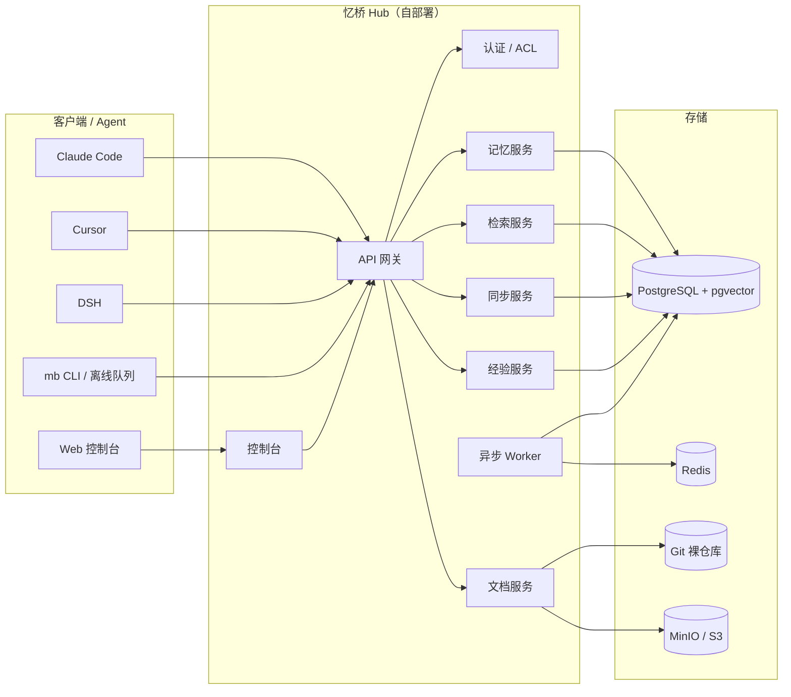

# MemoryBridge 架构概览

- 状态：v0.2（立项阶段，随 PRD 与 ADR 更新）
- 范围：单用户、2 设备、3 个 agent、3 个项目
- 详细需求见 [产品需求文档](../需求/MemoryBridge-产品需求文档.md) 第 6 章
- 完整决策、备选与复审条件见 [ADR 架构决策文档](MemoryBridge-ADR架构决策文档.md)

## 1. 设计目标

1. **自部署**：单机 Docker Compose 可跑，数据可带走。
2. **跨设备**：离线可写、增量同步、冲突可解释，不丢更新。
3. **跨 agent**：MCP 优先，不绑定单一运行时。
4. **治理优先**：来源、置信度、时效、敏感级、信任级、审计。
5. **经验可复用**：轨迹 → 候选经验 → 验证 → 晋升 → 退役。
6. **文档即记忆**：Markdown + Git，可被引用到章节。

## 2. 组件

| 组件 | 职责 |
|---|---|
| API 网关 | 认证、限流、路由、OpenAPI |
| 记忆服务 | Memory Item 生命周期、版本、冲突 |
| 检索服务 | BM25 + 向量 + 图扩展 + 重排 + Context Pack |
| 同步服务 | op log、游标、幂等、墓碑 |
| 文档服务 | Git 仓库、解析、chunk、diff |
| 经验服务 | 反思、候选、验证、晋升、退役 |
| Worker | 抽取、embedding、整理、衰减 |

## 3. 关键数据流

**写入**：Agent → MCP 代理（脱敏 + outbox）→ Hub API → Episode → 队列 → Worker 抽取 → 去重/冲突 → Memory candidate → 审核/索引。

**读取**：Agent → `memory_search` → BM25/向量召回 → 融合 + 作用域/时间过滤 → 1-hop 图扩展 → 重排 → token 预算打包 → 带引用的 Context Pack。

**同步**：客户端产生不可变 op → 推送 → 服务端按 `op_id` 幂等应用并分配 `seq` → 其他设备按游标拉取 → 冲突进入队列。

## 4. 关键决策（ADR 摘要）

完整决策、备选方案、代价与复审条件见 [ADR 架构决策文档](MemoryBridge-ADR架构决策文档.md)。当前基线：

- **自进化边界**：外部经验记忆，不更新模型权重（ADR-001）。
- **范围**：单用户、2 设备、3 个 agent、3 个项目（ADR-002）。
- **接入**：MCP 优先，CLI/Hook 补充（ADR-003）。
- **记忆**：Episode + 结构化 Memory Item + Provenance（ADR-004）。
- **写入**：自动采集 + 候选/审核，全局晋升需人工确认（ADR-005）。
- **同步**：服务端权威 op log + 客户端游标（ADR-006）。
- **冲突**：字段级合并 + 冲突副本 + 人工裁决（ADR-007）。
- **存储**：PostgreSQL + pgvector + 全文检索（ADR-008，W2 spike 验证）。
- **检索**：混合召回 + 图扩展 + 重排 + Context Pack（ADR-009，W6 评测）。
- **经验**：候选 → 验证 → 晋升 → 退役（ADR-010）。
- **文档**：Markdown + Git 为真相（ADR-011）。
- **权限**：本地账号 + 设备 token + Space ACL（ADR-012）。
- **安全**：采集前脱敏、信任级、审计；E2EE 暂缓（ADR-013）。
- **部署**：单机 Docker Compose（ADR-014）。
- **复用**：自研薄流水线，接口可替换（ADR-015，W2 前定）。
- **评测**：公开基准 + CrossProjectBench + 消融（ADR-016）。

尚未定稿的选型（存储、检索、复用策略、许可证）在 ADR 中标记为“建议/待决策”，实施前必须过对应门槛，不得把建议写成已实现。

## 5. 数据模型（摘要）

| 实体 | 作用 |
|---|---|
| Space | 作用域树（personal / project / team） |
| Episode | 原始证据，只追加 |
| Memory Item | 结构化记忆，带类型/置信度/时效/来源/证据 |
| Candidate | 抽取后待审核的记忆；active 前不可检索 |
| Memory Edge | relates_to / derived_from / supersedes / contradicts / applies_to |
| Skill | 经验蒸馏后的可复用流程，带触发条件与验证记录 |
| Document / Doc Chunk | Markdown 文档与可检索片段 |
| Op Log | 同步操作日志，服务端分配 seq |
| Conflict | 冲突副本与裁决状态 |
| Audit Log | 谁在何时对哪条记忆做了什么 |

字段级定义见 PRD §6.6–6.7。

## 6. 部署

- 单机 Docker Compose：Caddy + api + worker + web + Postgres + Redis + MinIO。
- 最低 2C4G / 40GB；推荐 4C8G / 100GB。
- 只暴露 443；备份 `pg_dump` + 对象存储，定期恢复演练。
- 本地模型可选（Ollama + bge-m3）；课程演示建议 API embedding。

## 7. MVP 实现状态

| 能力 | 目标架构 | 当前 MVP |
|---|---|---|
| MCP 接入 | stdio + HTTP，Resources/Prompts | stdio + resources/prompts；远程靠本地 proxy |
| Identity / Gate | 版本化 Identity Pack + context_version | 已实现 |
| 存储 | PostgreSQL + pgvector | SQLite 单文件 |
| 检索 | 混合召回 + 图扩展 + 重排 | 词法（英文词 + 中文双字） |
| 跨设备 | op log + 冲突副本 | 中心 HTTP Hub + 本地 proxy + Bearer |
| 文档 | Markdown + Git | SQLite 文档表 + 词法检索 |
| 技能 | 候选→验证→晋升 | 最小 skills 表 + 状态字段 |
| 抽取 | LLM 抽取/去重/冲突 | 规则 + 可选 LLM（OpenAI 兼容，失败回退）；语义去重未接 |
| 鉴权 | 账号/OIDC + 设备 token | 单一 Bearer token |
| 部署 | Docker Compose | Dockerfile/compose 已提供；本机 Docker Hub 不可达，未完成构建验证 |
| 控制台 | Web 管理/审核 | Hub 自带单页 Web UI（概览/采集/记忆/候选/文档/技能/身份） |
| 评测 | CrossProjectBench + 消融 | 30 个功能测试，迁移实验未开始 |

## 8. 待定项

以下问题的完整背景、触发条件与负责人见 [ADR 架构决策文档](MemoryBridge-ADR架构决策文档.md) 的 ADR-017 与附录 A：

1. 同步是否在 10 万条后引入分片/外部向量库。
2. 是否复用 Mem0/Graphiti 作为抽取/图组件，还是保持自研薄流水线。
3. E2EE 与检索的取舍（客户端 embedding / 可搜索加密）。
4. 多用户团队版的权限模型。
5. 许可证（建议 Apache-2.0）。

## 9. 非目标

不训练/微调模型；不做多租户 SaaS、实时协作、移动端、通用图数据库运维。以上为 P2 或不做。
