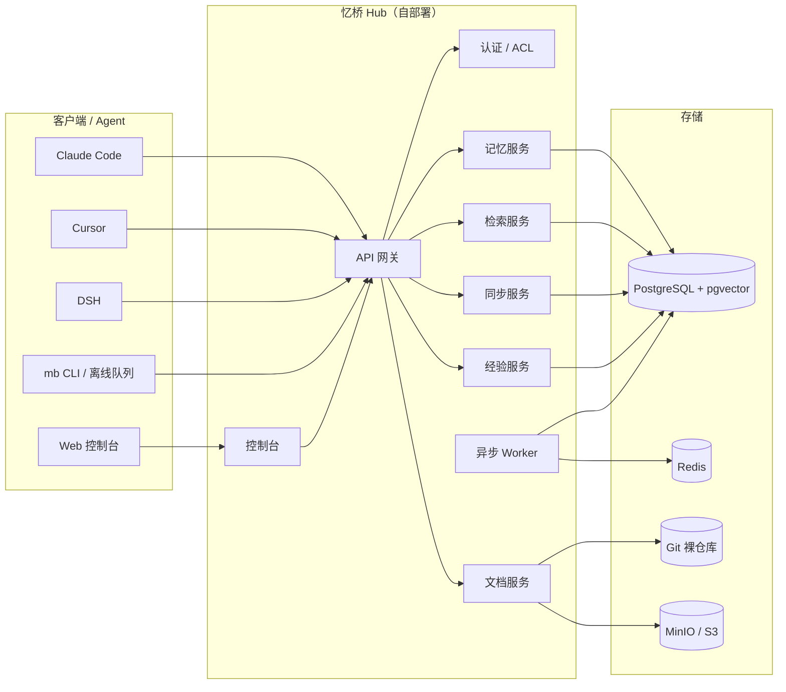

# MemoryBridge 架构概览

- 状态：v0.1（立项阶段，随 PRD 更新）
- 范围：单用户、2 设备、3 个 agent、3 个项目
- 详细需求见 [产品需求文档](../需求/MemoryBridge-产品需求文档.md) 第 6 章

## 1. 设计目标

1. **自部署**：单机 Docker Compose 可跑，数据可带走。
2. **跨设备**：离线可写、增量同步、冲突可解释，不丢更新。
3. **跨 agent**：MCP 优先，不绑定单一运行时。
4. **治理优先**：来源、置信度、时效、敏感级、信任级、审计。
5. **经验可复用**：轨迹 → 候选经验 → 验证 → 晋升 → 退役。
6. **文档即记忆**：Markdown + Git，可被引用到章节。

## 2. 组件

| 组件 | 职责 |
|---|---|
| API 网关 | 认证、限流、路由、OpenAPI |
| 记忆服务 | Memory Item 生命周期、版本、冲突 |
| 检索服务 | BM25 + 向量 + 图扩展 + 重排 + Context Pack |
| 同步服务 | op log、游标、幂等、墓碑 |
| 文档服务 | Git 仓库、解析、chunk、diff |
| 经验服务 | 反思、候选、验证、晋升、退役 |
| Worker | 抽取、embedding、整理、衰减 |

## 3. 关键数据流

**写入**：Agent → MCP 代理（脱敏 + outbox）→ Hub API → Episode → 队列 → Worker 抽取 → 去重/冲突 → Memory candidate → 审核/索引。

**读取**：Agent → `memory_search` → BM25/向量召回 → 融合 + 作用域/时间过滤 → 1-hop 图扩展 → 重排 → token 预算打包 → 带引用的 Context Pack。

**同步**：客户端产生不可变 op → 推送 → 服务端按 `op_id` 幂等应用并分配 `seq` → 其他设备按游标拉取 → 冲突进入队列。

## 4. 关键决策（ADR 摘要）

| 编号 | 决策 | 选择 | 放弃 |
|---|---|---|---|
| ADR-01 | 同步模型 | 服务端权威 + op log + 客户端游标 | 全文 CRDT |
| ADR-02 | 存储 | PostgreSQL + pgvector + tsvector | 专用向量库 + 图库（P2） |
| ADR-03 | 接入 | MCP 优先，CLI/Hook 补充 | 每家写插件 |
| ADR-04 | 经验演化 | 候选 → 验证 → 晋升 → 退役 | 自动全量写入 |
| ADR-05 | 加密 | TLS + 静态加密；E2EE 放 P2 | 一开始 E2EE |
| ADR-06 | 部署 | 单机 Docker Compose | K8s |
| ADR-07 | 文档 | Markdown + Git 为真相 | 数据库存正文 |

## 5. 数据模型（摘要）

| 实体 | 作用 |
|---|---|
| Space | 作用域树（personal / project / team） |
| Episode | 原始证据，只追加 |
| Memory Item | 结构化记忆，带类型/置信度/时效/来源 |
| Memory Edge | relates_to / derived_from / supersedes / contradicts / applies_to |
| Skill | 经验蒸馏后的可复用流程，带触发条件与验证记录 |
| Document / Doc Chunk | Markdown 文档与可检索片段 |
| Op Log | 同步操作日志，服务端分配 seq |
| Conflict | 冲突副本与裁决状态 |
| Audit Log | 谁在何时对哪条记忆做了什么 |

字段级定义见 PRD §6.6–6.7。

## 6. 部署

- 单机 Docker Compose：Caddy + api + worker + web + Postgres + Redis + MinIO。
- 最低 2C4G / 40GB；推荐 4C8G / 100GB。
- 只暴露 443；备份 `pg_dump` + 对象存储，定期恢复演练。
- 本地模型可选（Ollama + bge-m3）；课程演示建议 API embedding。

## 7. 待定项

1. 同步是否在 10 万条后引入分片/外部向量库。
2. 是否复用 Mem0/Graphiti 作为抽取/图组件，还是保持自研薄流水线。
3. E2EE 与检索的取舍（客户端 embedding / 可搜索加密）。
4. 多用户团队版的权限模型。
5. 许可证（建议 Apache-2.0）。

## 8. 非目标

不训练/微调模型；不做多租户 SaaS、实时协作、移动端、通用图数据库运维。以上为 P2 或不做。
