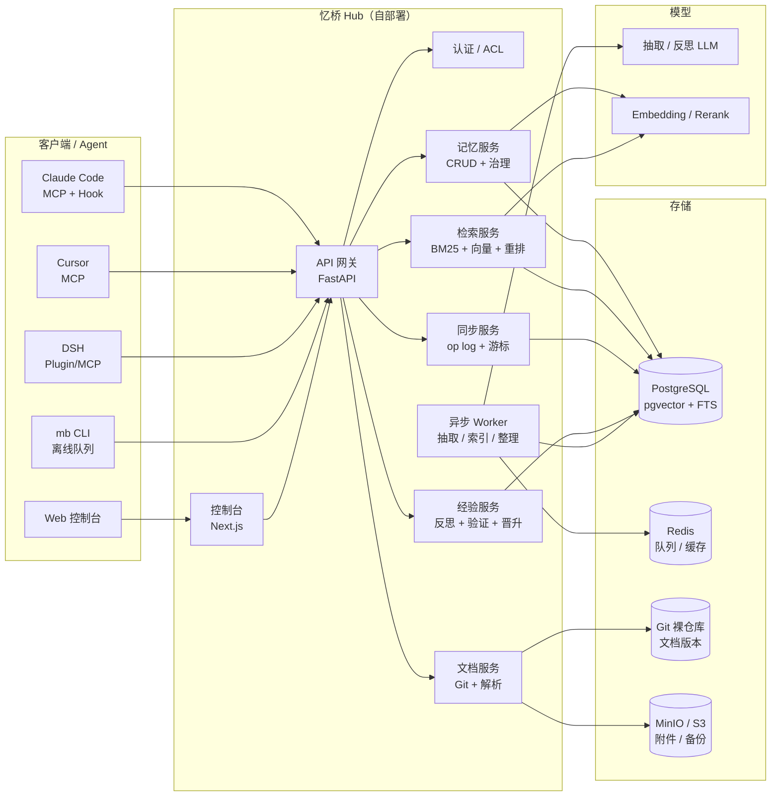
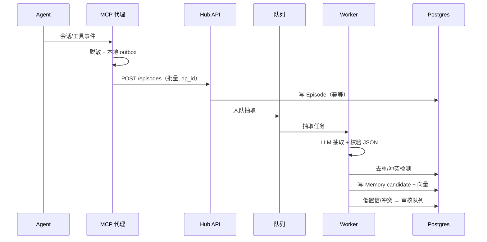
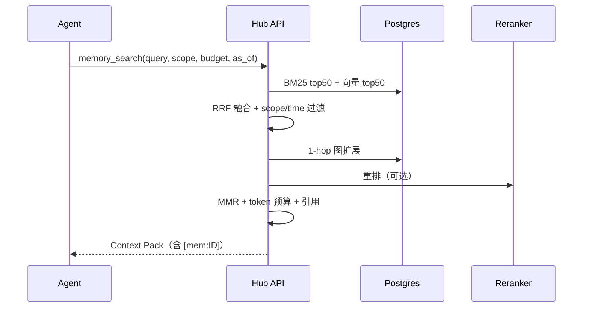
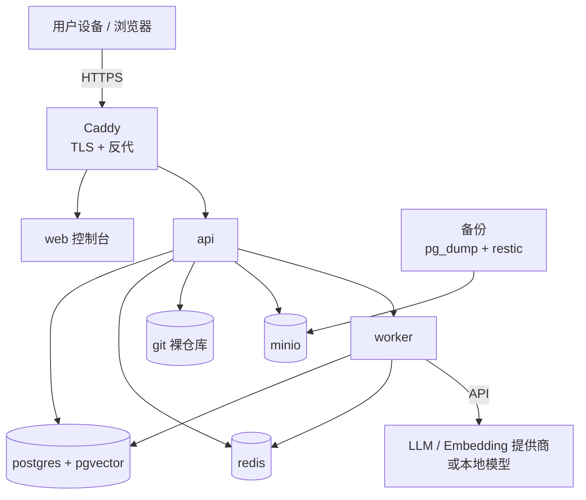
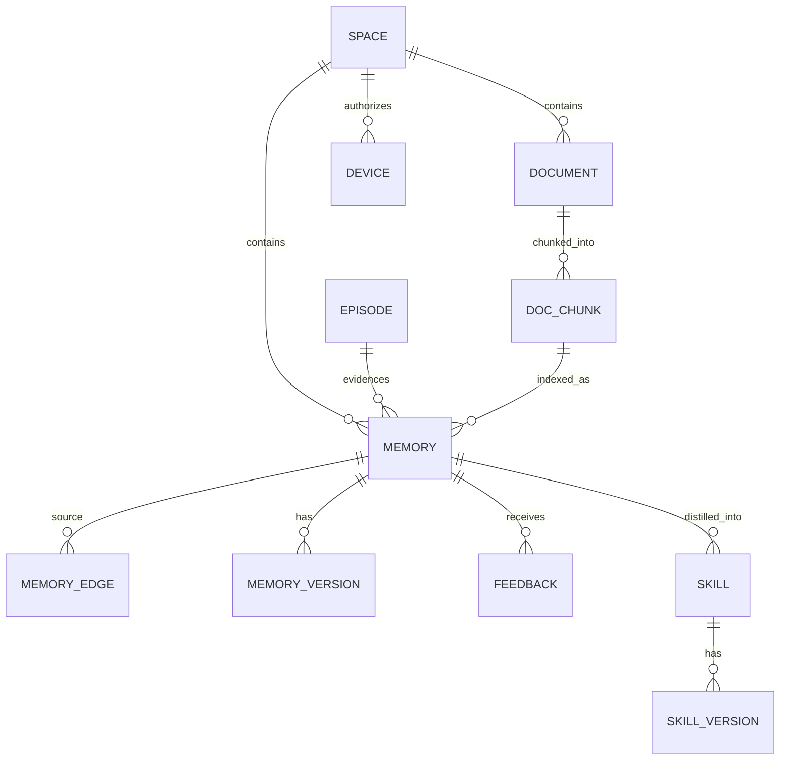
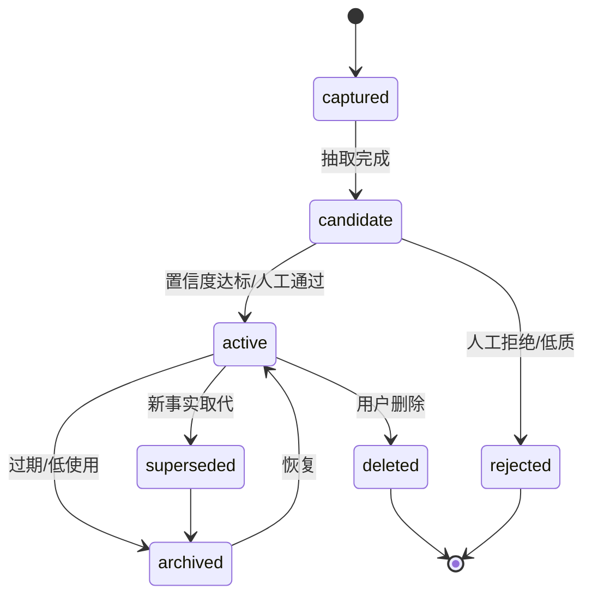

# 忆桥 MemoryBridge — 产品需求文档（PRD）

| 项目 | 内容 |
|---|---|
| 产品名 | 忆桥 MemoryBridge（内部代号 `membridge`） |
| 文档版本 | v1.0（课程大作业立项版） |
| 日期 | 2026-10-21 |
| 作者 | 待填（课程小组） |
| 状态 | 待评审 |
| 关联文档 | [调研与可行性](../调研/MemoryBridge-调研与可行性.md) |
| 课程场景 | 本科/研究生课程大作业，12 周，3 人小组 |

> **实现说明（2026-10-21）**：用户明确要求“AI 有意识地调用 MCP 直接维护，UI 只读，不做候选/人工批准”。实现以 ADR-005（AI 直接写 + topic/scope/audit）为准；本文中候选/审核/采集相关描述作为早期输入保留，不再作为当前实现承诺。

> **一句话**：一个自部署的“记忆护照”——任何设备、任何 agent、任何项目，通过同一套有出处、会过期、可冲突合并、能沉淀经验的记忆与文档中枢工作。

---

## 0. 摘要（给评审与答辩评委）

**问题**：AI agent 的记忆被锁在单台电脑、单个工具、单个项目里。换电脑要重新调教，换项目要重新解释偏好与架构，踩过的坑不会变成下一次的经验。

**方案**：自部署 Hub（Docker Compose）+ MCP 接入 + 控制台。Agent 的会话/工具轨迹被采集为 **Episode**，经 LLM 提炼为结构化 **Memory Item**（事实/偏好/决策/教训/流程），经治理（去重、冲突、时效、来源、信任级）后进入检索；任务结束后把成功/失败轨迹蒸馏为 **候选经验**，通过验证与人工审核后“晋升”为可跨项目复用的 **Skill**。文档（ADR/SOP/笔记）以 Markdown + Git 管理，同时作为一等记忆被检索。

**差异化**：不是再做一个 Mem0。重点是 ①跨设备同步是一等公民（离线队列 + 冲突可解释）；②治理优先（来源/时效/信任/审计）；③经验“候选—验证—晋升—退役”闭环；④文档与记忆一体；⑤用自建跨项目基准证明“经验到底有没有用”。

**课程交付**：可运行原型（2 设备 × 3 agent × 3 项目）、评测报告、演示视频、15–20 页报告、答辩 PPT。

**可行性结论**：技术可行，工程量刚好；必须砍掉多租户、实时协作、端到端加密、移动端。详见[调研报告](../调研/MemoryBridge-调研与可行性.md)。

---

## 1. 背景与定位

### 1.1 问题

| 断点 | 现象 | 代价 |
|---|---|---|
| 设备 | 公司台式机 / 家里笔记本 / 服务器各一份记忆 | 换机即失忆，重复调教 |
| 工具 | `CLAUDE.md`、`AGENTS.md`、Cursor rules、ChatGPT memory 互不相通 | 每个工具重复解释 |
| 项目 | 项目 A 的架构决策、踩坑、SOP，项目 B 不知道 | 重复犯错，重复调研 |
| 文档 | ADR/SOP/笔记散落，agent 检索不到或检索到过期版本 | 文档沦为“写给人看”的摆设 |

### 1.2 现有方案为什么不够

- **内置记忆**（CLAUDE.md / AGENTS.md / rules / ChatGPT memory）：轻，但绑定单工具或单仓库，无跨设备、无治理、无经验晋升。
- **Mem0 / OpenMemory**：抽取—整合—检索成熟，但共享边界通常是“同一台机器”；跨设备要自建同步或使用其云；治理偏黑盒。
- **MemOS / Letta / Graphiti**：能力强，但分别偏“记忆 OS”“agent 运行时”“时序图数据库”，自部署重，且不覆盖文档库与经验审核。
- **basic-memory / ByteRover**：分别证明“Markdown + MCP”和“记忆像代码一样版本化”可行，但治理/经验层或自部署/许可不满足需求。

### 1.3 产品定位

> **个人开发者/小团队的自部署记忆与文档中枢**：不追求替代 SaaS，不追求通用 Memory OS；追求“我的记忆我做主、换机换项目不重来、经验可验证地复用”。

### 1.4 设计原则

1. **记忆是数据，不是提示词**：结构化、可查询、可审计、可删除。
2. **无出处不记忆**：每条记忆必须能回溯到 Episode 或文档片段。
3. **治理优先于自动化**：宁可让用户确认，也不让错误记忆污染全局。
4. **自部署优先**：单机可跑、数据可带走、无强制云依赖。
5. **协议优先于插件**：MCP 接入，避免为每个 agent 写一套。
6. **可证伪**：所有“更聪明”的主张都要有指标与对照。

### 1.5 非目标（明确不做）

- 不训练/微调模型，不做参数级“自进化”。
- 不做多租户 SaaS、计费、企业 SSO（P2 以后）。
- 不做实时多人协同编辑（文档用 Git 合并）。
- 不做移动端 App（响应式 Web 即可）。
- 不做端到端加密（P2；与服务端 embedding 冲突，需专项设计）。
- 不做通用图数据库/向量数据库运维（P2 再评估 Neo4j）。
- 不承诺“全自动、零确认”的记忆写入。

### 1.6 本项目对“自进化”的定义

课程报告里必须避免把“自进化”说成模型变聪明了。本项目采用可证伪的工程定义：

> **自进化 = 在不更新模型权重的前提下，把任务轨迹转化为可检索、可验证、可复用的经验记忆；当同类任务再次出现时，agent 调用这些经验，从而在成功率、轮次或 token 成本上获得可测量改进。**

它属于“外部化持续学习”（externalized continual learning），对应综述中的 token-level / experiential memory，而不是参数级自更新。由此提出三个待检验假设：

- **H1（结构化优于原始 RAG）**：结构化经验记忆比“原始对话切片 + 向量检索”带来更高的跨项目任务成功率。
- **H2（验证优于未验证）**：经过“验证—晋升”的经验比未验证候选经验带来更高增益、更低负迁移。
- **H3（治理降低错误）**：冲突合并、时效与来源信任能降低过期/错误记忆导致的错误率。

第 7 节的 RQ1–RQ4 与消融实验就是围绕这三个假设设计的；即使结果为负，也能给出“经验记忆在什么条件下有效”的结论。

---

## 2. 用户与场景

### 2.1 Persona

**P1 研究生开发者“小陈”（主用户）**
- 2 台电脑（实验室台式 + 个人笔记本），常用 Claude Code、Cursor、DSH。
- 同时做课程项目、科研代码、个人 side project。
- 痛点：每次换机要重新讲偏好；项目间的工程经验不复用；文档越写越散。
- 期望：装一次，之后“它记得我”；能看到、能改、能删；不把代码/密钥传到不可控的云。

**P2 小团队负责人“阿岚”（次用户，P2）**
- 3–5 人，希望共享项目约定、踩坑库、SOP，但各自保留私人记忆。
- 期望：空间隔离、成员权限、共享文档与经验审核。

### 2.2 Jobs to be Done

- 当我换一台电脑时，我希望 agent 仍然知道我的技术栈偏好、代码风格、常用命令，不需要重新解释。
- 当我在新项目里遇到相似问题时，我希望 agent 主动提醒“你之前在 X 项目踩过这个坑，做法是 Y”。
- 当我做出一个架构决策时，我希望它被记录为带理由和相关文档的决策记忆，而不是消失在聊天记录里。
- 当一条记忆过期或与事实冲突时，我希望系统标记它、让我确认，而不是继续自信地使用。
- 当我想把某条经验分享给其他项目时，我希望先验证它，再决定是否“晋升”为全局经验。

### 2.3 核心旅程

| 阶段 | 用户动作 | 系统行为 |
|---|---|---|
| Day 0 | `docker compose up`，浏览器初始化，生成设备 token | 创建 personal space，写入默认偏好模板 |
| Day 1 | 在 Claude Code 里正常干活 | Hook/MCP 采集 episode；夜间抽取记忆；控制台出现待审核条目 |
| Day 3 | 换笔记本，登录同一 Hub | 增量拉取记忆；agent 首次对话即召回偏好与项目约定 |
| Day 7 | 在项目 B 遇到项目 A 的问题 | 检索命中“教训”记忆；Context Pack 附出处与置信度 |
| Day 30 | 回看经验库 | 看到已验证的 Skill、使用次数、成功率；退役过时经验 |

### 2.4 关键场景（验收用）

- **S1 换机不失忆**：A 机教会“提交信息用中文、Python 用 uv、测试用 pytest -q”；B 机新会话直接遵守。
- **S2 跨项目迁移**：在项目 A 学会“FastAPI 分页用 cursor 而不是 offset”；项目 B（另一个 FastAPI 服务）agent 主动采用并说明来源。
- **S3 冲突可解释**：A 机记“部署在 Vercel”，B 机记“部署在 Cloudflare”；同步后不静默覆盖，进入冲突队列，用户裁决。
- **S4 经验晋升**：项目 A 的失败复盘生成候选经验；在沙箱/人工验证后晋升为全局 Skill；项目 B 命中并成功使用。
- **S5 文档即记忆**：上传 ADR，agent 回答“为什么选 Postgres”时引用该 ADR 的章节与版本。
- **S6 安全**：对话里出现 API key，采集前被拦截/脱敏；恶意文档中的“忽略之前指令”被标记为不可信内容。

---

## 3. 目标与指标

### 3.1 产品目标

- **O1 可用**：2 台设备、3 个 agent、3 个项目之间稳定共享记忆与文档。
- **O2 可信**：每条记忆可追溯、可编辑、可删除；冲突与过期可见。
- **O3 有效**：跨项目任务在成功率/轮次/token 上相对无记忆基线有可测量提升。
- **O4 可运维**：单机部署、备份恢复、升级迁移有文档与脚本。

### 3.2 北极星指标

> **跨项目记忆复用率（Cross-Project Reuse Rate, CPRR）**：在新项目中，agent 实际引用且被判定为“有帮助”的、来源于其他项目的记忆条数 / 新项目任务数。

辅助指标：任务成功率提升、完成轮次下降、token 成本下降、重复错误率下降。

### 3.3 指标体系

| 维度 | 指标 | 目标（MVP） | 测量方式 |
|---|---|---|---|
| 采纳 | 周活跃设备/agent | ≥2 设备、≥3 agent | 服务端埋点 |
| 质量 | 记忆抽取精确率 | ≥0.80 | 200 条人工标注集 |
| 质量 | 检索 P@5 | ≥0.70 | 100 条查询评测集 |
| 质量 | 冲突误合并率 | ≤2% | 注入冲突测试 |
| 效率 | 任务成功率相对提升 | ≥10%（至少 2/3 项目对） | CrossProjectBench |
| 效率 | 完成轮次下降 | ≥15% | 同上 |
| 效率 | token 成本下降 | ≥20% | 同上 |
| 同步 | 并发编辑收敛 | 100% 无丢失更新 | 3 设备模拟测试 |
| 同步 | 在线同步延迟 p95 | ≤3s（100 ops） | 压测 |
| 安全 | 密钥泄露率 | 0（测试集） | 50 条含密钥样本 |
| 安全 | 投毒记忆被标记率 | ≥90% | 20 条注入样本 |
| 成本 | 月度基础设施 | <¥100 | 账单 |
| 运维 | 备份恢复演练 | 1 次成功 | 演练记录 |

### 3.4 课程验收指标（必须）

1. 现场演示 2 台设备（或 2 个独立客户端配置）共享记忆。
2. 至少 3 个 agent 接入（建议 Claude Code / Cursor / DSH，或其中 2 个 + REST）。
3. CrossProjectBench v0.1 跑通，给出基线对比与消融。
4. 同步收敛测试与安全测试有脚本、有结果。
5. 代码可复现：`docker compose up` + 种子数据 + 一键评测。

---

## 4. 功能需求

> 优先级：P0 = MVP 必须；P1 = 有时间就做，答辩加分；P2 = 未来演进，不承诺。
> 验收统一遵循“可演示、可测试、有数据”的原则。

### 4.0 功能地图

| 模块 | 一句话 | 优先级 |
|---|---|---|
| F1 接入与采集 | 把 agent 的经历变成可追溯的 Episode | P0 |
| F2 提炼与结构化 | 把 Episode 变成有类型的 Memory Item | P0 |
| F3 治理与生命周期 | 去重、冲突、时效、审核、删除 | P0 |
| F4 检索与注入 | 在正确的作用域/时间点，用有限 token 召回 | P0 |
| F5 跨设备同步 | 离线可写、增量同步、冲突可解释 | P0 |
| F6 文档库 | Markdown + Git，文档即记忆 | P1 |
| F7 经验蒸馏与晋升 | 从轨迹到可复用 Skill 的闭环 | P1（创新核心） |
| F8 控制台 | 看得见、改得动、审得了 | P1 |
| F9 安全与隐私 | 不泄密、不被投毒、可删除 | P0 |
| F10 多空间/协作 | 团队共享与隔离 | P2 |
| F11 运维与可观测 | 部署、备份、升级、指标 | P1 |

### 4.1 F1 接入与采集（P0）

**目标**：任何 agent 以最低成本接入；采集不打断工作流；敏感信息不落库。

| ID | 需求 | 优先级 | 验收标准 |
|---|---|---|---|
| FR-101 | 提供 MCP Server（stdio 本地代理 + HTTP 远程），暴露 `memory_search` / `memory_add` / `memory_update` / `memory_forget` / `memory_feedback` | P0 | Claude Code/Cursor 任一可完成“搜索—注入—写回” |
| FR-102 | 提供会话 Hook：session_start / user_turn / assistant_turn / tool_call_summary / session_end，可配置采样率 | P0 | 一次真实任务产生 ≥1 个 Episode，字段完整 |
| FR-103 | CLI：`mb remember`、`mb search`、`mb sync`、`mb status`、`mb import` | P0 | 5 条命令可用，退出码正确 |
| FR-104 | 导入：Markdown 目录、ChatGPT/Claude 导出 JSON | P1 | 导入 100 条不重复、可回溯 |
| FR-105 | 采集前脱敏：正则（API key/JWT/私钥/密码）+ 高熵字符串 + 可选 LLM 判定；命中 `secret` 级直接阻断 | P0 | 50 条密钥样本 0 落库；误杀率 ≤5% |
| FR-106 | 离线队列：本地 SQLite outbox，断网可写，恢复后按 `op_id` 幂等重放 | P0 | 断网 30 分钟后恢复，无重复、无丢失 |
| FR-107 | 设备与 agent 身份：`device_id`、`agent_id`、能力声明、可撤销 token | P0 | 撤销后 1 分钟内拒绝写入 |

**规则**：
- 默认只采集“用户消息 + assistant 摘要 + 工具调用摘要”，不采集完整文件内容与大段代码；代码以路径 + 摘要 + 可选片段形式引用。
- 采集 fail-open：采集失败不影响主任务；但写入失败要进 outbox 并提示。
- 每条 Episode 存 `source`（agent/tool/url）、`occurred_at`、`content_hash`、`sensitivity`。

### 4.2 F2 提炼与结构化（P0）

**目标**：把噪声轨迹变成“少而准”的记忆；每条都有证据。

| ID | 需求 | 优先级 | 验收标准 |
|---|---|---|---|
| FR-201 | 记忆类型：`fact` / `preference` / `decision` / `lesson` / `procedure` / `reference` | P0 | 抽取结果类型分布合理；人工抽检 ≥80% 正确 |
| FR-202 | LLM 抽取输出严格 JSON Schema，必须含 `claim`、`evidence_quote`、`type`、`scope`、`confidence` | P0 | 100 次抽取 0 解析失败（重试后） |
| FR-203 | 实体/标签/作用域推断：项目、技术栈、文件路径、人物、组织 | P0 | 实体召回 ≥0.7（标注集） |
| FR-204 | 去重：内容哈希 + 语义近邻（cosine ≥0.90）+ LLM 判定（重复/细化/矛盾/独立） | P0 | 重复率 ≤5%；误合并 ≤2% |
| FR-205 | 冲突检测：矛盾进入 `contradicts` 边 + 审核队列，不静默覆盖 | P0 | 注入 20 组冲突，全部进入队列 |
| FR-206 | 置信度与重要性打分：显式程度、重复次数、用户确认、来源可靠度、使用效果 | P0 | 分数可解释（有特征快照） |
| FR-207 | 异步批处理：按 session 聚合、限流、重试、成本上限、失败降级为“原始 Episode 可检索” | P0 | 1 万 token 会话抽取 p95 ≤60s |
| FR-208 | 抽取评测集：200 条中文/英文混合样本，含正/负/冲突 | P1 | 精确率/召回率可复现 |

**抽取 Schema（示例）**：

```json
{
  "type": "lesson",
  "claim": "在 Windows 上用 pytest 时，路径含空格会导致 fixture 失败，应使用 pathlib 并在 CI 中用引号包裹。",
  "evidence_quote": "……又挂了，原来是路径里有空格……改成 pathlib 好了",
  "scope": {"project": "itime", "tech": ["pytest", "windows"]},
  "entities": ["pytest", "pathlib", "Windows"],
  "confidence": 0.82,
  "importance": 0.7,
  "sensitivity": "internal",
  "valid_from": "2026-10-12",
  "tags": ["testing", "windows", "pitfall"]
}
```

### 4.3 F3 治理与生命周期（P0）

**目标**：记忆会过期、会冲突、会错；系统要能发现、能解释、能纠正。

| ID | 需求 | 优先级 | 验收标准 |
|---|---|---|---|
| FR-301 | 生命周期状态机：`captured → candidate → active → superseded / archived / deleted`；`rejected` 终态 | P0 | 非法跃迁被拒绝；状态变更留痕 |
| FR-302 | 审核队列：低置信、冲突、敏感、跨项目晋升四类 | P0 | 控制台可批量通过/拒绝/编辑 |
| FR-303 | 合并/拆分/编辑/软删除；删除写墓碑并广播 | P0 | 删除后所有设备 1 次同步内不可见 |
| FR-304 | 时效：`valid_from` / `valid_to`；支持 `as_of` 查询；过期自动降权 | P0 | “2025 年的部署方式”查询不返回 2026 年新事实 |
| FR-305 | 敏感级：`public` / `internal` / `private` / `secret`（禁止入库） | P0 | 跨 space 检索不越权 |
| FR-306 | 信任级：`unverified` / `verified` / `trusted`；全局晋升需 `verified` | P0 | 未验证经验不能进 global |
| FR-307 | 审计日志：谁、何时、对哪条记忆、做了什么、为什么 | P0 | 控制台可按条目追溯 |
| FR-308 | 导出与彻底删除（含向量、缓存、备份标记） | P1 | 导出 JSONL；删除 24h 内生效 |

**冲突处理规则**：

| 场景 | 处理 |
|---|---|
| 同字段并发修改 | 版本向量检测；保留两份，标 `conflict`，进审核队列 |
| 不同字段并发修改 | 字段级合并，自动通过 |
| 删除 vs 更新 | 删除优先，写墓碑；更新进“已删除条目”审核，可恢复 |
| 新旧事实矛盾 | 不自动覆盖；新事实 `active`，旧事实 `superseded` 需证据或人工确认 |
| 文档冲突 | Git 合并；冲突标记进审核；二进制保留两份 |

### 4.4 F4 检索与上下文注入（P0）

**目标**：在正确的作用域与时间点，用有限 token 给出“有出处的上下文”。

| ID | 需求 | 优先级 | 验收标准 |
|---|---|---|---|
| FR-401 | 混合检索：BM25（tsvector/FTS5）+ 向量（pgvector/HNSW）+ RRF 融合 | P0 | 100 查询 P@5 ≥0.70 |
| FR-402 | 作用域：personal / project / team；支持继承与显式排除 | P0 | 不越权；项目隔离可演示 |
| FR-403 | 时间过滤与 `as_of` | P0 | 时间旅行查询正确 |
| FR-404 | 图扩展：1-hop `relates_to` / `derived_from` / `supersedes` | P1 | 多跳问题召回提升可测 |
| FR-405 | 重排：bge-reranker-v2-m3（可选开关） | P1 | NDCG@5 相对提升 ≥5% |
| FR-406 | Context Pack：token 预算（默认 1500）、去重、MMR 多样性、逐条引用 `[mem:ID]`、置信度与时效提示 | P0 | 超预算时按价值裁剪；引用可点击 |
| FR-407 | 反馈：`used` / `helpful` / `harmful` / `wrong`，更新 utility 分 | P0 | 反馈 1 次内影响下一次排序 |
| FR-408 | 降级：向量服务不可用时退化为 FTS + 图扩展 | P0 | 断 embedding 仍可返回结果 |
| FR-409 | 检索评测集：100 条查询（中英各半，含时间/冲突/跨项目） | P1 | 脚本一键跑出 P@5/R@5 |

**排序（两阶段）**：

1. 召回：`top 50` by RRF(BM25, vector) + scope/time filter + 1-hop expansion。
2. 精排：`score = 0.30*rerank + 0.20*utility + 0.15*confidence + 0.10*recency + 0.10*scope_prior + 0.15*type_prior`，再按 token 预算做 MMR 打包。

> 权重是初始值，第 11 周用评测集调参；报告里给出消融。

### 4.5 F5 跨设备同步（P0）

**目标**：多设备像用同一个大脑；断网也能写；冲突不丢数据、可解释。

| ID | 需求 | 优先级 | 验收标准 |
|---|---|---|---|
| FR-501 | 设备注册/撤销；每设备独立 token 与游标 | P0 | 新设备 5 分钟内完成首次全量同步 |
| FR-502 | 不可变 op log：`op_id`(ULID)、`device_id`、`hlc`、`entity`、`op_type`、`payload`、`base_version` | P0 | 重放 1000 次结果一致（幂等） |
| FR-503 | 增量拉取 `GET /sync/changes?since=seq`，分页 + 墓碑 | P0 | 10 万条变更可分页拉完 |
| FR-504 | 冲突检测（版本向量）+ 冲突副本 + 审核队列 | P0 | 3 设备并发 100 op，无丢失更新 |
| FR-505 | 离线 outbox + 指数退避 + 手动重试 | P0 | 断网 24h 后恢复，顺序正确 |
| FR-506 | 同步状态：CLI `mb status` + 控制台设备页（最后同步、待推、冲突数） | P0 | 状态与实际一致 |
| FR-507 | 文档 Git 同步：本地 commit → push 裸仓库 → 其他设备 pull | P1 | 两端历史一致；冲突可解 |
| FR-508 | 收敛测试脚本：模拟 3 设备、随机 200 op、断网/重连 | P0 | CI 可跑，失败即阻断 |

**op 信封（示例）**：

```json
{
  "op_id": "01JABY3K9M4Q7R2T5V8X1C6D0E",
  "device_id": "dev_macbook",
  "agent_id": "claude-code",
  "hlc": "2026-10-21T15:20:09.123Z-0007-dev_macbook",
  "op_type": "memory.upsert",
  "entity_id": "mem_01JABY...",
  "base_version": 3,
  "payload": {"content": "...", "tags": ["pytest"]},
  "created_at": "2026-10-21T15:20:09Z"
}
```

### 4.6 F6 文档库（P1）

**目标**：文档既给人看，也能被 agent 当记忆用；版本可追溯。

| ID | 需求 | 优先级 | 验收标准 |
|---|---|---|---|
| FR-601 | Markdown canonical（frontmatter + 正文 + `[[wiki-link]]`），文件系统即真相 | P1 | Obsidian 可直接打开 |
| FR-602 | 每个 space 一个 Git 仓库；每次保存自动 commit；支持 diff/history/回滚 | P1 | 控制台可看 diff 并回滚 |
| FR-603 | 上传 PDF/DOCX/MD，抽取文本、按标题/页切块、保留页码/章节锚点 | P1 | 10 份文档解析成功率 ≥90% |
| FR-604 | 文档块作为 `reference` 记忆入索引，带文档 ID/版本/锚点 | P1 | 回答可引用到“第 3.2 节” |
| FR-605 | 文档与记忆互链：记忆引用文档，文档反链相关记忆 | P1 | 详情页可跳转 |
| FR-606 | 导出为 Obsidian vault / 静态站点 | P2 | 导出后链接可用 |

### 4.7 F7 经验蒸馏与晋升（P1，创新核心）

**目标**：把“这次怎么做的”变成“下次遇到同类问题怎么做”，并且**先验证再共享**。

| ID | 需求 | 优先级 | 验收标准 |
|---|---|---|---|
| FR-701 | 任务结束反思：成功/失败、目标、关键步骤、卡点、可复用点 | P1 | 每个完成任务生成 1 条 reflection |
| FR-702 | 候选经验 Schema：`trigger`（何时适用）、`steps`、`preconditions`、`evidence`、`counterexamples`、`scope` | P1 | 结构完整率 ≥90% |
| FR-703 | 验证：沙箱重放 / 人工确认 / 相似任务 A-B；至少 1 种通过 | P1 | 验证记录可查 |
| FR-704 | 晋升：project skill → global skill；带版本、适用范围、失效条件 | P1 | 未验证不可晋升 |
| FR-705 | 退役：低成功率/长期未用/被新版本取代 → `deprecated` | P1 | 退役后不再默认注入 |
| FR-706 | 技能注入：按 trigger 匹配，最多 2 条，附步骤与出处 | P1 | 注入不超 token 预算 |
| FR-707 | 负迁移防护：scope guard、冲突警告、失败回滚 | P1 | 跨项目误用可一键回滚 |

**经验 Schema（示例）**：

```json
{
  "skill_id": "skill_01JAC...",
  "name": "Windows 路径含空格时的 pytest 修复",
  "trigger": "pytest 在 Windows 上因路径含空格失败",
  "preconditions": ["Windows", "pytest", "路径含空格"],
  "steps": [
    "用 pathlib.Path 构造路径",
    "在 subprocess 调用中给路径加引号",
    "CI 中用 -o cache_dir 指向无空格目录"
  ],
  "evidence": ["mem_01JAB...", "ep_01JAB..."],
  "counterexamples": ["Linux 下通常不需要"],
  "scope": {"tech": ["pytest", "windows"]},
  "status": "validated",
  "success_count": 3,
  "failure_count": 0,
  "version": 1
}
```

**晋升门槛（默认）**：验证通过 + 人工确认 + 证据 ≥2 条 + 无未解决冲突。可在设置中调整。

### 4.8 F8 控制台（P1）

| ID | 需求 | 优先级 | 验收标准 |
|---|---|---|---|
| FR-801 | 记忆浏览：按 space/type/status/tag/时间筛选，全文+语义搜索 | P1 | 1 万条下翻页流畅 |
| FR-802 | 记忆详情：内容、证据、来源、版本历史、关联、审计 | P1 | 可编辑并触发新版本 |
| FR-803 | 审核队列：冲突/低置信/敏感/晋升四类，批量操作 | P1 | 键盘可完成 10 条审核 |
| FR-804 | 图谱视图：节点=记忆/文档/实体，边=关系；可过滤 | P2 | 1k 节点可交互 |
| FR-805 | 设备与同步：在线状态、最后同步、待推、冲突 | P1 | 与实际一致 |
| FR-806 | 文档：树形浏览、编辑、diff、上传 | P1 | 保存即 commit |
| FR-807 | 设置：模型/embedding、保留期、脱敏规则、token 预算 | P1 | 改动有审计 |
| FR-808 | 统计：记忆增长、类型分布、检索命中、复用率、成本 | P2 | 图表可导出 |

### 4.9 F9 安全与隐私（P0）

| ID | 需求 | 优先级 | 验收标准 |
|---|---|---|---|
| FR-901 | 认证：本地账号 + 设备 token；密码 Argon2；会话 cookie HttpOnly | P0 | 未认证无法访问 API |
| FR-902 | 授权：space 级 ACL；agent token 限定 scope 与读写 | P0 | 越权测试全部拒绝 |
| FR-903 | 密钥扫描：正则 + 熵 + 可选 LLM；`secret` 级阻断 | P0 | 测试集 0 落库 |
| FR-904 | 提示注入防护：记忆内容包裹为“数据”，指令性内容标记；不可信来源不参与全局晋升 | P0 | 20 条注入样本 ≥90% 标记 |
| FR-905 | 传输 TLS；静态加密（磁盘/对象存储）；备份加密 | P0 | 抓包无明文 |
| FR-906 | 限流与配额：按 token/设备/IP | P0 | 压测不雪崩 |
| FR-907 | 备份/恢复：每日 pg_dump + 对象存储；恢复演练 | P1 | RTO ≤1h，RPO ≤24h |
| FR-908 | 依赖扫描与镜像最小化 | P1 | CI 无高危漏洞 |

### 4.10 F10 多空间/协作（P2）

- 团队 space、成员角色（owner/editor/viewer）、邀请链接。
- 成员私有记忆与团队共享记忆隔离；共享需显式“发布”。
- 经验晋升到团队级需管理员审核。
- **不承诺**在课程周期内完成。

### 4.11 F11 运维与可观测（P1）

| ID | 需求 | 优先级 | 验收标准 |
|---|---|---|---|
| FR-1101 | 一键部署：`docker compose up -d`，含迁移与种子数据 | P1 | 新机器 15 分钟可用 |
| FR-1102 | 健康检查 `/healthz`、`/readyz`；依赖状态 | P0 | 故障可定位 |
| FR-1103 | 指标：请求、延迟、抽取队列、同步积压、成本 | P1 | Prometheus 可抓 |
| FR-1104 | 结构化日志 + request_id + 审计分离 | P1 | 可按请求追踪 |
| FR-1105 | 升级：镜像 tag + 迁移脚本 + 回滚说明 | P1 | 演练一次 |
| FR-1106 | 演示种子数据：3 项目、2 设备、若干记忆/文档 | P1 | 一键导入 |

---

## 5. 非功能需求

| ID | 类别 | 要求 |
|---|---|---|
| NFR-1 | 性能 | 5 万条记忆、4C8G：检索 p95 ≤400ms；Context Pack（含重排）≤1.5s；100 ops 同步 ≤3s |
| NFR-2 | 可靠性 | 单节点可用性 ≥99%；崩溃不丢已确认写入（WAL）；采集 fail-open |
| NFR-3 | 扩展性 | 10 万条记忆、10 设备、5 agent 不显著退化；预留分片/外部向量库接口 |
| NFR-4 | 安全 | 参考 OWASP ASVS L1；密钥零落库；审计不可篡改（追加写） |
| NFR-5 | 隐私 | 数据自托管；支持导出/删除；不向第三方发送未脱敏内容 |
| NFR-6 | 兼容 | MCP 2025-11-25；Claude Code / Cursor / Codex / DSH 至少 3 个；Markdown/Obsidian |
| NFR-7 | 可维护 | API 有 OpenAPI；数据库迁移；核心模块测试覆盖 ≥60% |
| NFR-8 | 成本 | 月度 <¥100；5 万条记忆存储 <10GB（不含附件） |
| NFR-9 | 国际化 | 中英文内容可检索；UI 中文优先，文案可切换 |
| NFR-10 | 可访问性 | 控制台键盘可操作、对比度达标、错误信息可读 |

---

## 6. 系统设计

### 6.1 总体架构



### 6.2 组件职责

| 组件 | 职责 | 关键约束 |
|---|---|---|
| API 网关 | 认证、限流、路由、OpenAPI | 无状态，可水平扩展 |
| 记忆服务 | Memory Item 生命周期、版本、冲突 | 所有写入走 op log |
| 检索服务 | 混合召回、过滤、重排、打包 | 只读副本可扩展 |
| 同步服务 | op 接收/去重/排序、变更流 | 幂等、游标稳定 |
| 文档服务 | Git 仓库、解析、chunk、diff | 文件系统/Git 为真相 |
| 经验服务 | 反思、候选、验证、晋升、退役 | 未验证不共享 |
| Worker | 抽取、embedding、整理、衰减 | 可重试、可观测 |
| 控制台 | 人机界面 | 不绕过 API |

### 6.3 关键数据流

**采集 → 记忆**：



**检索 → 注入**：



### 6.4 部署拓扑



- 最低配置：2C4G / 40GB；推荐 4C8G / 100GB。
- 单机 Docker Compose；NAS/家用服务器/VPS 均可。
- 反向代理 + 自动 TLS；只暴露 443。
- 本地模型可选：Ollama + bge-m3（CPU 可跑，慢）；课程演示建议 API embedding。

### 6.5 技术选型

| 层 | 选择 | 理由 | 备选 |
|---|---|---|---|
| API | Python 3.12 + FastAPI | 生态、异步、OpenAPI | Node/NestJS |
| DB | PostgreSQL 16 + pgvector + tsvector | 事务 + 向量 + 全文一体 | SQLite + sqlite-vec（更轻） |
| 队列 | Redis + Arq | 轻量、异步 | Celery / BullMQ |
| 文档 | Git（裸仓库）+ Markdown | 人可读、可 diff、可迁移 | Gitea API |
| 前端 | Next.js + Tailwind | 快速出控制台 | SvelteKit |
| MCP | 官方 Python/TS SDK | 兼容性 | 自研 JSON-RPC |
| Embedding | bge-m3（1024d）或 Qwen3-Embedding-0.6B | 中文强、多语言 | OpenAI text-embedding-3 |
| 重排 | bge-reranker-v2-m3 | 性价比 | Cohere Rerank |
| LLM | DeepSeek / Qwen / 本地 Ollama | 成本与隐私可切换 | OpenAI/Claude |
| 观测 | OpenTelemetry + Prometheus | 标准 | 日志 only |

**为什么不用图数据库**：MVP 的关系查询 1–2 跳，Postgres 递归 CTE 足够；Neo4j 运维成本高，留到 P2。

**为什么不用 CRDT**：记忆条目是“小文档 + 字段”，冲突频率低；服务端权威 + 版本向量 + 冲突副本更简单、更可审计。

### 6.6 数据模型



| 表 | 关键字段 | 说明 |
|---|---|---|
| `spaces` | id, name, kind(personal/project/team), parent_id | 作用域树 |
| `devices` | id, name, token_hash, last_seen, revoked_at | 设备 |
| `agents` | id, name, kind, capabilities | agent 身份 |
| `episodes` | id, space_id, device_id, agent_id, occurred_at, content, content_hash, sensitivity, meta | 原始证据，只追加 |
| `memories` | id, space_id, type, content, structured(jsonb), status, confidence, importance, sensitivity, trust, valid_from, valid_to, version, created_by, hash | 记忆主表 |
| `memory_versions` | memory_id, version, diff, actor, created_at | 版本历史 |
| `memory_edges` | from_id, to_id, relation, confidence, created_by | relates_to/derived_from/supersedes/contradicts/applies_to |
| `memory_embeddings` | memory_id, model, dim, vector | 向量（可多模型） |
| `feedback` | memory_id, device_id, signal, context, created_at | 使用反馈 |
| `skills` | id, name, trigger, scope, status, version, success/failure | 经验/技能 |
| `skill_versions` | skill_id, version, steps, evidence, validation | 版本 |
| `documents` | id, space_id, path, title, git_commit, mime, hash | 文档 |
| `doc_chunks` | id, document_id, ordinal, text, anchor, embedding | 文档块 |
| `op_log` | seq, op_id, device_id, hlc, op_type, entity_id, base_version, payload, applied_at | 同步日志 |
| `conflicts` | id, entity_id, left_op, right_op, status, resolution | 冲突队列 |
| `audit_log` | id, actor, action, entity, before, after, at | 审计 |
| `jobs` | id, type, status, attempts, payload, result | 异步任务 |

### 6.7 记忆 Schema

```json
{
  "id": "mem_01JABY3K9M4Q7R2T5V8X1C6D0E",
  "space_id": "sp_personal",
  "type": "preference",
  "content": "提交信息使用中文，格式为 <type>(<scope>): <摘要>。",
  "structured": {
    "subject": "git commit",
    "rule": "中文 + conventional commits",
    "examples": ["feat(api): 增加同步游标"]
  },
  "status": "active",
  "confidence": 0.92,
  "importance": 0.8,
  "sensitivity": "internal",
  "trust": "verified",
  "valid_from": "2026-09-01",
  "valid_to": null,
  "scope": {"project": null, "tech": ["git"], "global": true},
  "entities": ["git", "commit"],
  "evidence": ["ep_01JAB..."],
  "version": 2,
  "created_by": "dev_macbook",
  "hash": "sha256:..."
}
```

### 6.8 API 设计（REST，节选）

| 方法 | 路径 | 说明 |
|---|---|---|
| POST | `/v1/spaces` | 创建空间 |
| GET | `/v1/spaces` | 列出空间 |
| POST | `/v1/episodes` | 批量写入 Episode（幂等） |
| POST | `/v1/memories` | 手动创建记忆 |
| GET | `/v1/memories` | 列表/筛选 |
| GET | `/v1/memories/{id}` | 详情（含证据/历史/边） |
| PATCH | `/v1/memories/{id}` | 编辑（乐观锁 `version`） |
| DELETE | `/v1/memories/{id}` | 软删除 + 墓碑 |
| POST | `/v1/memories/search` | 混合检索 |
| POST | `/v1/memories/{id}/feedback` | 反馈 |
| POST | `/v1/memories/{id}/promote` | 晋升（需权限） |
| GET | `/v1/sync/changes?since=` | 增量变更 |
| POST | `/v1/sync/ops` | 推送操作（幂等） |
| GET | `/v1/conflicts` | 冲突列表 |
| POST | `/v1/conflicts/{id}/resolve` | 裁决 |
| GET/PUT | `/v1/docs/{path}` | 文档读写 |
| POST | `/v1/docs/upload` | 上传解析 |
| GET | `/v1/skills` | 技能列表 |
| POST | `/v1/skills/{id}/validate` | 验证 |
| POST | `/v1/skills/{id}/promote` | 晋升 |
| GET | `/healthz` | 健康检查 |

**检索请求/响应示例**（`POST /v1/memories/search`）：

```json
{
  "query": "这个项目分页为什么不用 offset",
  "spaces": ["sp_project_b"],
  "as_of": "2026-10-21",
  "k": 8,
  "token_budget": 1200,
  "include_skills": true
}
```

```json
{
  "items": [
    {
      "memory_id": "mem_01JAB...",
      "type": "decision",
      "content": "列表分页使用 cursor，避免深 offset 性能退化。",
      "confidence": 0.88,
      "valid_from": "2026-08-14",
      "source": {"kind": "episode", "id": "ep_01JAB...", "agent": "claude-code"},
      "citation": "[mem:mem_01JAB...]"
    }
  ],
  "skills": [
    {"skill_id": "skill_01JAC...", "name": "Cursor 分页实现", "status": "validated"}
  ],
  "tokens_used": 842,
  "degraded": false
}
```

### 6.9 MCP 接口

| 类型 | 名称 | 输入 | 输出 |
|---|---|---|---|
| Tool | `memory_search` | query, spaces, as_of, k, token_budget | Context Pack |
| Tool | `memory_add` | content, type, scope, evidence | memory_id |
| Tool | `memory_update` | id, patch, version | new version |
| Tool | `memory_forget` | id, reason | tombstone |
| Tool | `memory_feedback` | id, signal, context | ack |
| Tool | `context_pack` | task, space, budget | 打包上下文 |
| Tool | `skill_list` | scope, trigger | 技能列表 |
| Resource | `memory://{space}/{id}` | — | 记忆详情 |
| Resource | `doc://{space}/{path}` | — | 文档内容 |
| Prompt | `recall_for_task` | task description | 引导 agent 先检索再行动 |

> 兼容策略：MCP 版本协商；对不支持 Resources 的客户端降级为 Tools；所有工具 fail-open（检索失败返回空 + 警告，不阻塞任务）。

### 6.10 同步协议

**模型**：服务端权威 + 不可变 op log + 客户端游标。客户端可离线写，恢复后推送。

**op 类型**：`episode.append`、`memory.upsert`、`memory.delete`、`memory.merge`、`memory.feedback`、`skill.promote`、`doc.commit`。

**版本与冲突**：

- 每条记忆维护 `version`（整数）与 `version_vector`（device_id → counter）。
- 推送时带 `base_version`；服务端比较：
  - `base_version == current`：直接应用，version+1。
  - `base_version < current` 且字段不相交：字段级合并。
  - 字段相交：生成冲突副本，原条目保持，冲突进队列。
  - 删除 vs 更新：墓碑优先；更新进“待恢复”队列。

**变更流**：服务端为每个 op 分配单调 `seq`；客户端 `GET /v1/sync/changes?since=seq` 拉取，应用后更新游标；墓碑同样传播。

**幂等**：`op_id` 唯一索引；重复推送返回已应用结果。**顺序**：同一实体按 HLC 排序；跨实体无全局顺序要求。

**收敛测试**：3 个模拟设备，随机 200 个 op（含并发编辑、删除、断网 30%），最终状态哈希一致、无丢失更新、重复应用结果一致。

### 6.11 经验蒸馏算法（伪代码）

```text
on_task_complete(episode_batch, outcome):
  reflection = LLM.reflect(episode_batch, outcome)   # 目标/步骤/卡点/可复用点
  candidates = LLM.extract_skills(reflection, schema=SkillSchema)
  for c in candidates:
      c.evidence = links_to_episodes(c)
      c.status = "candidate"
      if conflict_with_existing(c): c.status = "needs_review"
      save(c)

validate(skill):
  if human_approved(skill): return "validated"
  results = replay_in_sandbox(skill, similar_tasks(k=3))
  if results.success_rate >= 2/3: return "validated"
  return "rejected"

promote(skill, target_scope):
  require skill.status == "validated"
  require skill.evidence.count >= 2
  require no_open_conflicts(skill)
  require human_confirm if target_scope == "global"
  create new version with scope=target_scope
  audit(...)

retire(skill):
  if skill.success_rate < 0.5 and skill.uses >= 5: deprecate
  if skill.last_used > 180d and skill.scope == "global": deprecate
```

### 6.12 安全威胁模型

| 威胁 | 场景 | 对策 |
|---|---|---|
| 密钥泄露 | 用户把 key 贴进对话 | 采集前扫描/阻断；日志脱敏；审计 |
| 记忆投毒 | 恶意文档/网页写入“忽略指令” | 内容包裹为数据；指令检测；来源信任级；全局晋升人工确认 |
| 越权读取 | 项目 B 读到项目 A 私有记忆 | space ACL + 查询强制过滤 + 测试 |
| 设备被盗 | token 泄露 | 可撤销 token、短期会话、审计异常 |
| 供应链 | 依赖/镜像漏洞 | 锁定版本、最小镜像、扫描 |
| 模型外泄 | 发送到第三方 LLM | 可切换本地模型；脱敏；隐私模式 |
| 删除不彻底 | 备份/缓存残留 | 删除标记传播；备份保留策略；文档说明 |

---

## 7. 评测方案

### 7.1 研究问题

- **RQ1（质量）**：结构化记忆 + 治理，相比原始对话 RAG，检索与问答质量如何？
- **RQ2（迁移）**：跨项目经验记忆能否提升新项目任务成功率/降低轮次与 token？
- **RQ3（治理）**：冲突合并、时效、晋升门槛分别贡献多少？去掉会怎样？
- **RQ4（可信）**：同步是否收敛？投毒/泄密防护是否有效？

### 7.2 数据集

| 数据集 | 用途 | 规模 |
|---|---|---|
| LoCoMo | 长对话记忆问答（单/多跳/时序/开放） | 取 10 段对话 |
| LongMemEval-S | 长历史记忆（知识更新、时序、多会话） | 500 题（或子集） |
| **CrossProjectBench（自建）** | 跨项目经验迁移 | 3 组项目对 × 12 任务 = 36 |
| 安全测试集 | 密钥/投毒 | 50 + 20 条 |
| 同步测试 | 并发/离线 | 3 设备 × 200 op |

**CrossProjectBench 设计**：

- 项目对：①FastAPI 服务 A/B；②React 后台 A/B；③课程项目 A/B（同一技术栈不同业务）。
- 每组：在 A 完成 6 个“教学任务”（产生经验），在 B 完成 6 个“评测任务”（结构相似、表面不同）。
- 任务 rubric：功能正确（0/1）、测试通过（0/1）、代码规范（0–2）、是否复用经验（0–2）。
- 双人盲评，Cohen's κ ≥0.6；分歧仲裁。

### 7.3 基线

| 编号 | 基线 | 说明 |
|---|---|---|
| B0 | 无记忆 | 每次从零 |
| B1 | 全上下文 | 塞入全部历史（受窗口限制） |
| B2 | 朴素 RAG | 对话 chunk + 向量检索 |
| B3 | 结构化记忆（Mem0 式） | 抽取 + 去重 + 检索，无经验晋升 |
| B4 | 本方案 w/o 经验 | 有治理与文档，无 Skill |
| B5 | 本方案 full | 全部能力 |

### 7.4 指标与统计

- 质量：P@5、R@5、NDCG@5、答案正确率（LLM-as-judge + 人工抽检）。
- 迁移：任务成功率、完成轮次、token、墙钟时间、重复错误率、CPRR。
- 治理：冲突误合并率、过期记忆误用率、负迁移率。
- 同步：收敛率、丢失更新数、重放一致性。
- 安全：密钥落库率、投毒标记率、越权拒绝率。
- 统计：bootstrap 10k 置信区间；配对 Wilcoxon；报告效应量（Cliff's delta）；显著性 α=0.05，多重比较校正。

### 7.5 消融

| 消融 | 目的 |
|---|---|
| −图扩展 | 关系是否重要 |
| −重排 | 精排收益 |
| −冲突合并 | 治理价值 |
| −时效 | 过期记忆影响 |
| −晋升门槛 | 负迁移风险 |
| −文档记忆 | 文档一体化的贡献 |

### 7.6 预期结果与解释

- 预期 B5 > B4 > B3 > B2 > B0（成功率），token 低于 B1。
- 若迁移增益不显著：报告“经验记忆的收益主要集中在有明确流程的任务”，并给出误差分析；这仍是合格的研究结论。
- 若治理导致召回下降：分析“安全—效用”权衡，给出可配置策略。

---

## 8. 课程实施计划

### 8.1 团队分工（3 人）

| 角色 | 负责 | 产出 |
|---|---|---|
| A 后端/同步/基础设施 | Hub API、DB、op log、部署、备份 | 可部署服务、同步测试 |
| B 记忆流水线/评测 | 抽取、去重、检索、经验蒸馏、基准 | 评测报告、数据集 |
| C 前端/文档/演示 | 控制台、文档库、Demo、PPT/视频 | 可演示界面、答辩材料 |

> 两人组：A 兼 C 的部分；一人组：砍到“MCP + 记忆 CRUD + 检索 + 单机双客户端”，不做同步。

### 8.2 12 周计划

| 周 | 目标 | 交付/门槛 |
|---|---|---|
| W1 | 调研、需求、范围 | 调研报告 + 本 PRD（G0） |
| W2 | 架构、数据模型、API 契约、UI 线框 | 架构图 + OpenAPI 草案 |
| W3 | Hub 骨架、认证、space、记忆 CRUD | 本地可跑 |
| W4 | MCP 接入 + 采集 + 脱敏 | 2 agent 闭环（G1） |
| W5 | 抽取 + 去重 + 审核队列 | 100 条样本抽取评测 |
| W6 | 混合检索 + Context Pack + 反馈 | 检索 P@5 初测 |
| W7 | 同步协议 + 离线队列 + 冲突 | 2 设备收敛（G2） |
| W8 | 文档库 + Git + 上传解析 | 文档引用演示 |
| W9 | 经验蒸馏 + 验证 + 晋升 | 3 条 Skill 晋升；基准 v0.1（G3） |
| W10 | 控制台完善 + 安全加固 | 审核/同步/审计页面 |
| W11 | 实验：基线/消融/安全/同步 | 结果表 + 图（G4） |
| W12 | 部署、演示、报告、答辩 | 视频 + PPT + 最终报告 |

### 8.3 预算

| 项 | 金额 |
|---|---|
| VPS（3 个月） | ¥90–180 |
| LLM/Embedding API | ¥50–150 |
| 域名（可选） | ¥30 |
| 备份存储 | ¥0–30 |
| **合计** | **¥200–400** |

### 8.4 交付物

1. 本 PRD + 调研报告。
2. 可运行源码仓库（Hub、MCP 代理、控制台、部署脚本）。
3. `CrossProjectBench` 数据集与评测脚本。
4. 实验报告（基线/消融/安全/同步）。
5. 5–8 分钟演示视频。
6. 12–15 页答辩 PPT。
7. 15–20 页课程报告（建议章节见 8.6）。

### 8.5 答辩演示脚本（8 分钟）

| 时间 | 场景 | 要点 |
|---|---|---|
| 0:00–0:40 | 问题 | 换机/换项目重复调教的痛点 |
| 0:40–2:00 | S1 换机不失忆 | A 机教偏好 → B 机新会话遵守 |
| 2:00–3:20 | S2 跨项目迁移 | 项目 A 的决策在项目 B 被引用 |
| 3:20–4:20 | S3 冲突 | 两端改同一事实 → 冲突队列 → 裁决 |
| 4:20–5:40 | S4 经验晋升 | 失败复盘 → 候选 → 验证 → 全局 Skill → B 项目命中 |
| 5:40–6:40 | S5 文档即记忆 | ADR 引用到章节 |
| 6:40–7:30 | S6 安全 | 密钥拦截 + 投毒标记 |
| 7:30–8:00 | 数据 | 成功率/轮次/token/同步收敛 |

### 8.6 课程报告建议章节

1. 引言（问题、动机、贡献）
2. 相关工作（记忆分层、经验学习、记忆系统）
3. 需求与场景（Persona、用例）
4. 系统设计（架构、数据模型、同步、治理）
5. 经验蒸馏与晋升机制
6. 实现（技术栈、关键难点）
7. 评测（基准、基线、消融、结果）
8. 讨论（负迁移、隐私、局限）
9. 结论与未来工作
10. 附录（API、Schema、复现步骤）

### 8.7 评分点映射（通用）

| 评分维度 | 对应章节/交付 |
|---|---|
| 选题与调研 | 第 1–2 章 + 调研报告 |
| 需求分析 | 第 3 章 + 本 PRD 第 2–4 节 |
| 系统设计 | 第 4–6 章 + 架构图/ER 图 |
| 实现与工程 | 源码、部署脚本、测试 |
| 测试与评测 | 第 7 章 + 实验报告 |
| 创新性 | 经验晋升、治理、跨项目基准 |
| 文档与答辩 | 报告、PPT、视频、Demo |

---

## 9. 风险与对策

| 风险 | 概率 | 影响 | 对策 | 触发条件 |
|---|---|---|---|---|
| 范围蔓延 | 高 | 高 | 锁定 P0；P1 按周裁剪 | W6 仍未跑通闭环 |
| 抽取质量差 | 中 | 高 | Schema + few-shot + 审核 + 评测集 | 精确率 <0.7 |
| 同步复杂 | 中 | 中 | 服务端权威 + 字段级合并；不追求全自动 | 收敛测试失败 2 次 |
| 评测不显著 | 中 | 高 | 预注册 + 效应量 + 负结果分析 | W11 无 ≥10% 增益 |
| LLM 成本/延迟 | 低 | 中 | 小模型 + 批处理 + 缓存 | 月成本 >¥300 |
| 隐私/密钥 | 中 | 高 | 脱敏、阻断、审计、测试集 | 任一泄露 |
| 依赖变更 | 中 | 中 | 锁版本；MCP 适配层隔离 | 上游 breaking |
| 时间不足 | 中 | 高 | 每周门槛；砍 P1 | W8 进度落后 1 周 |

---

## 10. 开放问题与决策记录

> 完整 ADR（背景、备选、代价、验证与复审条件）见 [`doc/架构/MemoryBridge-ADR架构决策文档.md`](../架构/MemoryBridge-ADR架构决策文档.md)。下表为摘要，编号与 ADR 文档一致；冲突时以 ADR 文档为准。

| 编号 | 问题 | 当前决策 | 待定/复审 |
|---|---|---|---|
| ADR-006 | 同步用 CRDT 还是 op log | op log + 服务端权威 | W7 收敛测试后复审 |
| ADR-008 | 向量库/存储 | Postgres + pgvector + 全文 | W2 spike 后定 |
| ADR-015 | 是否复用 Mem0/Graphiti | 自研薄流水线，接口可替换 | W2 前定 |
| ADR-013 | E2EE | P2；先 TLS + 静态加密 | 若用户强需求再设计 |
| ADR-011 | 文档存储 | Markdown + Git | 团队版再评估对象存储 |
| ADR-017 | 多用户 | P2 | 课程周期内不做 |
| 附录 A Q-01 | 许可证 | 建议 Apache-2.0 | 与指导教师确认 |
| 附录 A Q-02 | 默认模型 | DeepSeek + bge-m3（API） | 隐私模式可切本地 |

**待确认问题（需用户/教师拍板）**：

1. 课程是否要求“必须有创新算法”，还是“系统实现 + 评测”即可？
2. 是否允许调用第三方 LLM API（涉及数据出境/隐私）？
3. 团队人数与可用 GPU（决定本地 embedding 是否可行）。
4. 是否需要提交 DOCX/PDF 格式报告（可后续导出）。

---

## 11. 附录

### 11.1 记忆类型定义

| 类型 | 定义 | 示例 | 默认作用域 |
|---|---|---|---|
| fact | 可验证的客观事实 | “这个仓库用 pnpm，不用 npm” | project |
| preference | 用户/团队偏好 | “提交信息用中文” | personal |
| decision | 有理由的决策（ADR 式） | “选 Postgres 因为需要事务 + 向量” | project |
| lesson | 踩坑/失败教训 | “Windows 路径空格导致 pytest 失败” | project → global（验证后） |
| procedure | 可执行步骤/SOP | “发布前跑 make check && make e2e” | project |
| reference | 文档/链接/代码位置 | “部署文档第 3.2 节” | project |

### 11.2 状态机



### 11.3 术语表

| 术语 | 含义 |
|---|---|
| Episode | 一次会话/工具调用的原始证据片段 |
| Memory Item | 从 Episode 提炼的结构化记忆 |
| Space | 记忆作用域（personal/project/team） |
| Provenance | 来源与证据链 |
| Context Pack | 按 token 预算打包、带引用的注入上下文 |
| Skill | 经验蒸馏后的可复用流程 |
| Promotion | 候选经验晋升为项目/全局技能 |
| CPRR | 跨项目记忆复用率 |
| HLC | 混合逻辑时钟，用于跨设备排序 |

### 11.4 复现步骤（目标状态）

```powershell
git clone <repo>
cd membridge
cp .env.example .env      # 填 LLM/Embedding key
docker compose up -d
# 打开 http://localhost:8080，初始化账号
# 设备安装 MCP 代理
npm i -g @membridge/cli
mb login --hub http://localhost:8080
mb sync
# 跑评测
make bench
```

### 11.5 参考

见[调研报告第 10 节](../调研/MemoryBridge-调研与可行性.md#10-参考文献与链接)。

---

## 12. 变更记录

| 版本 | 日期 | 变更 | 作者 |
|---|---|---|---|
| v1.0 | 2026-10-21 | 初版：调研结论、范围、功能、架构、同步、评测、12 周计划 | 待填 |
